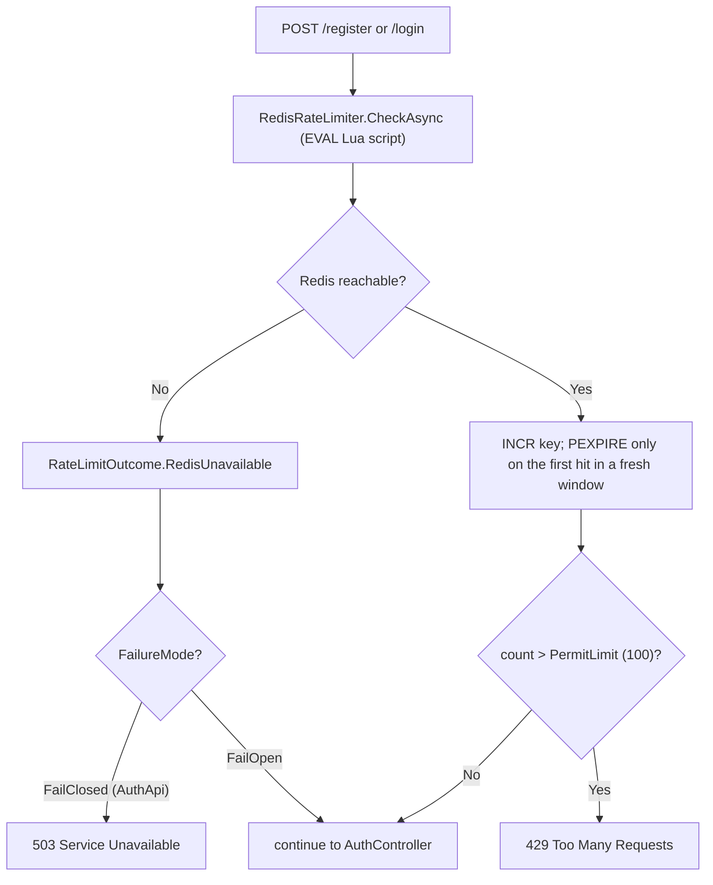

## What it is

An ASP.NET Core Web API — registration and login, the only service that issues JWTs. Owns
`users_db` (the only writer against it).

## What it solves

`LinkApi`/`RedirectApi` never require authentication (anonymous link creation is a deliberate
product decision — see [LinkApi](node:link-api)), but attaching a `userId` to a link so its
creator can later list their own links needs *some* identity system. AuthApi is that system,
deliberately kept separate from the services that consume its tokens.

## How it works

`POST /register`: hash the password (`PasswordHasher<T>`, PBKDF2, self-describing format — no
separately-stored salt needed), store the user, return a token (auto-login on signup, not a
separate required login step). `POST /login`: verify the hash, return a token. Both use the same
"Invalid email or password" message for "no such user" and "wrong password" — deliberate, avoids
leaking which emails are registered.

## How it's implemented here

```csharp
// src/backend/Services/AuthApi/Controllers/AuthController.cs:36
var normalizedEmail = NormalizeEmail(request.Email);
var emailTaken = await _context.Users.AnyAsync(x => x.Email == normalizedEmail, cancellationToken);
if (emailTaken) return EmailAlreadyRegistered();

var passwordHash = PasswordHasher.HashPassword(placeholder, request.Password);
var user = new User(Guid.NewGuid(), request.Name, normalizedEmail, passwordHash, string.Empty);

_context.Users.Add(user);
try { await _context.SaveChangesAsync(cancellationToken); }
catch (DbUpdateException) { return EmailAlreadyRegistered(); } // see this node's Pitfalls for why
```

Other services validate the tokens this issues without ever calling back into AuthApi: signing
key/issuer/audience live in `Common.Constants` so AuthApi (issuer) and `LinkApi` (validator) can't
drift onto different values, enforced in `docker-compose.yml` via one shared YAML anchor both
services reference.

### Rate limiting

`register`/`login`/`refresh`/`logout` sit behind a shared `RedisRateLimitFilter`
(`[ServiceFilter(typeof(RedisRateLimitFilter))]` on `AuthController`), keyed purely by
`RemoteIpAddress` — these endpoints are unauthenticated, so there's no logged-in caller to key on.
The counter itself (`RedisRateLimiter`, see [Async messaging](pattern:async-messaging)'s neighbor,
[Redis](node:redis-master)) is a fixed window, not sliding: `INCR` a per-key counter and, only on
the very first hit in a fresh window, `PEXPIRE` it — both inside one Lua script (`EVAL`), not two
separate round trips, so a crash between the two can't leave a key incremented but never expiring.
Default 100 requests/60s (`RateLimiting` in `appsettings.json`); request 101+ gets a `429` with the
same `ProblemDetails` shape as every other error here.



This replaced AuthApi's prior rate limiting outright — a per-process, in-memory fixed-window
counter — because AuthApi wasn't in `control-api`'s `ScalableServices` list, so "scale it past one
replica" would have silently turned the configured limit into `limit × replicas`. Moving the
counter into Redis (which AuthApi didn't depend on at all before this) fixes that, at the cost of a
new dependency on the hot auth path — which is why **AuthApi fails closed on a Redis outage**
(`503 Service Unavailable`, not a silently-open gate): these endpoints guard against
brute-forcing, so an open window during an outage would mean unlimited login attempts. This is a
deliberate exception to this project's usual "never block on a dependency outage" default used
elsewhere (caching, the request budget) — the right call here specifically because the thing being
protected is login, not a read.

AuthApi sits on a direct host port (8081), not behind `nginx` like `LinkApi`/`RedirectApi` — so
unlike `RedirectApi`'s rate limiter (see [RedirectApi](node:redirect-api)), it has no
`UseForwardedHeaders` call and doesn't need one; `RemoteIpAddress` is already the real client
address here. Its limit also has no docker-compose override knob (unlike `RedirectApi`'s) — the
100/60s default was already easy to trip in a demo, so there was no equivalent need to lower it
live.

The rate limiter's Redis dependency is a raw `AddRedisMultiplexer` connection (`AbortOnConnectFail=
false`), deliberately not `AddRedisDistributedCache` — AuthApi has no actual cache to warm, so
pulling in the full cache abstraction plus its memory-cache/warmup bundle just for the multiplexer
would be dead weight. That deliberate choice had left a real gap: no health check and no connection
warmup for that same multiplexer, so a cold first login/register paid the Redis connect cost on the
request path itself (`RateLimitFailureMode.LocalFallback`'s fail-open window covered it in the
meantime, but didn't make the cold hit free). Fixed by making `RedisWarmupService`'s
`IDistributedCache` dependency optional (resolved via `IServiceProvider.GetService<T>()`, same
pattern as its already-optional `IConnectionMultiplexer`) — when no `IDistributedCache` is
registered, as here, the cache half of the warmup is a no-op and only the multiplexer gets warmed.
`/health/ready` gained `.AddRedisHealthCheck()` (needs only the multiplexer, already registered),
and `RedisWarmupService` is now registered as a hosted service alongside the rate limiter, without
ever pulling in the cache bundle this service deliberately never needed.

## Pitfalls

- 🐛 [Duplicate-email race could crash Register with an unhandled exception](pitfall:auth-duplicate-email-race)
  (race-condition) — fixed
- 🐛 [Concurrent refresh-token rotations could fork the token family instead of detecting reuse](pitfall:auth-refresh-token-rotation-race)
  (race-condition) — fixed
- ⚠️ [A 401-triggered token refresh needs to be deduped across concurrent callers, or it will trip the very reuse-detection it's supposed to avoid](pitfall:frontend-401-no-retry-with-refresh-dedup)
  (resilience-gap) — fixed; the product frontend's own client-side half of this node's refresh-rotation mechanism

## Relatives

### Nodes

- [LinkApi](node:link-api) — optionally validates the tokens this node issues
- [users_db](node:users-db)
- [Redis](node:redis-master) — backs the rate limiter above

### Patterns

None yet.
