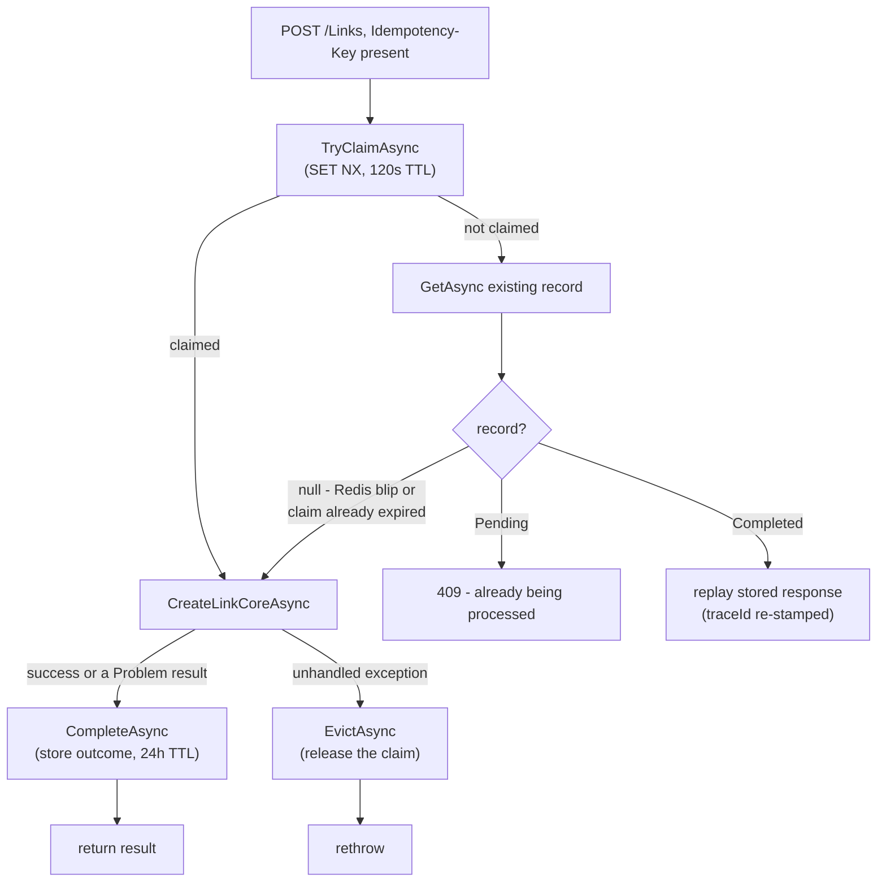

## What it is

An ASP.NET Core Web API — one of five .NET services in this project. Accepts link-creation
requests and serves reads (single-hash lookup and "my links" listing), plus authenticated-owner
deletion.

## What it solves

A short-link service needs to generate a hash and hand it back to the caller *fast* — but
persisting that link and everything downstream of it (the audit trail, eventual read scaling) can
happen a beat later. Making the caller wait for a database write on the hot creation path doesn't
buy anything the caller can observe, so LinkApi doesn't do one.

## How it works

`POST /Links` generates the hash itself (no database round trip needed for that) and returns it to
the caller *synchronously* — persistence happens asynchronously afterward. See
[Async messaging](pattern:async-messaging) for the mechanism.

`GET /Links/{hash}` is a cache-aside read — see [Caching](pattern:caching), including the
in-process L1 tier and negative caching sitting in front of/alongside Redis here.

## How it's implemented here

```csharp
// src/backend/Services/LinkApi/Controllers/LinksController.cs:206, CreateLinkCoreAsync (trimmed -
// reached from the top-level CreateLink action once any Idempotency-Key/custom-alias branching
// below has been resolved)
var hash = _hashGenerator.Generate(request.OriginalLink);
var linkCreatedEvent = new LinkCreatedEvent { Hash = hash, OriginalLink = request.OriginalLink, /* ... */ };
await _dispatcher.DispatchAsync(linkCreatedEvent, Topics.LinkCreated, cancellationToken);

// Optimistic cache write, short TTL - closes the PgCat read-your-writes race for an
// immediate redirect. See this node's Pitfalls for why. Written only after DispatchAsync
// succeeds, not before.
var link = new Link(hash, request.OriginalLink, hash, createdAt, userId, ExpiresAt: expiresAt);
await _service.CacheAsync(link, hash, cancellationToken, OptimisticCacheTtlSeconds);

return new LinkResponse(hash, createdAt); // returns before ShortenerService has persisted anything
```

The hash comes from `IHashGenerator` (`Sha256Base62HashGenerator` — SHA-256 of the original URL,
Base62-encoded, truncated), a pure function with no database dependency, which is what makes the
synchronous-return/async-persist split possible in the first place.

`DispatchAsync` goes through `IEventDispatcher`, not a direct publisher call — see
[Async messaging](pattern:async-messaging) for the RabbitMQ/gRPC transport toggle this abstracts
over. The cache write only happens after it succeeds, not before (see this node's Pitfalls).

A Bearer token is read *optionally* — `CreateLink` has no `[Authorize]`, so anonymous callers work
identically to authenticated ones; the only difference is whether `Link.UserId` ends up populated
from the token's `sub` claim. `GetLinks` (the "my links" listing) is the opposite: it requires
either a valid Bearer token or control-api's internal API key scheme, and always filters by caller.

**Custom aliases are the one exception to "always synchronous-return, async-persist."** When
`LinkCreateRequest.Alias` is set (authenticated callers only — `401` otherwise), `CreateLink`
branches to a different path that calls ShortenerService synchronously over gRPC and only returns
once the row is confirmed persisted or the alias is confirmed taken — see
[Custom aliases](pattern:custom-aliases) for why a real uniqueness guarantee needs that trade-off
even though the plain-hash path deliberately never makes it.

**`DELETE /Links/{hash}` is owner-only and publishes through the same `IEventDispatcher` as
`CreateLink`** - no forced transport the way custom aliases force sync gRPC; delete respects
whichever messaging mode is active. Anonymous links (`UserId == null`) can never be deleted by
anyone, and a caller who isn't the link's own owner gets `403`, not `404` - the hash is already in
their hands (they're asking to delete it), so there's nothing extra to protect by pretending it
doesn't exist. An already-deleted hash returns `204` idempotently instead of erroring. The handler
dispatches `LinkDeletedEvent` first and only then writes an optimistic "deleted" marker to a
*separate* Redis key (`link:deleted:{hash}`, not the main `link:{hash}` cache entry) via
`ILinkDeletionMarkerStore` - mirroring `CreateLink`'s own dispatch-before-optimistic-write ordering
above, in the opposite direction; see this node's Pitfalls for the review-caught bug this ordering
fixes (writing the tombstone first left a false 60s "Gone" page behind for a link whose delete had
actually failed, under `Messaging:Mode=grpc`). See [RedirectApi](node:redirect-api) for why that
key is checked first on every resolve, and [ShortenerService](node:shortener-service) for how the
marker gets confirmed. `CreateLink` also
accepts an optional `TtlSeconds`, converted once to an absolute `ExpiresAt` and carried on
`LinkCreatedEvent` for both the plain-hash and custom-alias paths - see ShortenerService's
`LinkExpiryWorker` for what actually acts on it. `GetLinks` filters out deleted and expired links
by default; there's no "show them anyway" toggle, since nothing in this feature calls for one.
`GetLink` (the single-hash lookup) applies the identical live check and returns `410 Gone` for a
deleted/expired hash instead of its stale metadata — it didn't always; see this node's Pitfalls for
the review-caught inconsistency that left it disagreeing with `GetLinks` about whether a gone link
still existed.

### `Idempotency-Key`: replaying a retry instead of minting a second link

`POST /Links` is at-least-once by default: if a client's connection drops after the hash was
already generated and dispatched, the normal, correct client behavior (retry) risks minting a
second link for one logical user action. An optional `Idempotency-Key` header closes that, opt-in,
without giving up the fast synchronous return described above.

```csharp
// src/backend/Services/LinkApi/Controllers/LinksController.cs:119, CreateLinkIdempotentlyAsync (trimmed)
if (!await _idempotency.TryClaimAsync(idempotencyKey, cancellationToken))
{
    var existing = await _idempotency.GetAsync(idempotencyKey, cancellationToken);
    if (existing is null)
        return await CreateLinkCoreAsync(request, cancellationToken); // fail open on a transient read gap
    if (existing.Status == IdempotencyStatus.Pending)
        return Problem(detail: "...already being processed...", statusCode: 409);
    return BuildReplayResult(existing); // byte-identical response, no new hash, no re-publish
}

try
{
    var result = await CreateLinkCoreAsync(request, cancellationToken);
    var (statusCode, contentType, bodyJson) = ExtractForReplay(result);
    await _idempotency.CompleteAsync(idempotencyKey, statusCode, contentType, bodyJson, cancellationToken);
    return result;
}
catch
{
    await _idempotency.EvictAsync(idempotencyKey, cancellationToken); // releases a claim this caller won but never completed
    throw;
}
```



`RedisIdempotencyStore` (`src/backend/Shared/Infrastructure/IdempotencyStore.cs`) holds one record
per key at `idempotency:links-create:{key}`, with the same two-tier TTL shape as
`ILinkDeletionMarkerStore`: a short in-flight claim (120s — see this node's Pitfalls for why not
30s) so a crashed request's claim self-expires instead of blocking retries for the full 24h
completed-record TTL that a finished response replays from. **Every** outcome — success, or any
`Problem()` result — is cached and replayed identically; only an unhandled exception evicts the
claim instead, since that's not a deterministic, safe-to-replay outcome. No header → no behavior
change at all, same at-least-once semantics as before this feature existed. Fails open on a Redis
error, same spirit as every other Redis-backed store in this codebase — a Redis outage silently
degrades back to at-least-once for the duration, it never fails the request.

There is deliberately no `control-api`/`architecture-map` toggle for this — it's per-request client
behavior (a header), not a standing infra on/off switch with persistent state for a panel to show.

### Graceful shutdown

`AddGracefulShutdown()` (`src/backend/Shared/WebDefaults/WebApiDefaultsExtensions.cs`), called from
this service's `Program.cs`, sets `HostOptions.ShutdownTimeout = 15s` — paired with
`stop_grace_period: 20s` on this service's `docker-compose.yml` block, so a scale-down or
`docker compose stop` drains in-flight requests instead of risking a mid-request kill. See
[this node's Pitfalls](pitfall:shutdown-timeout-is-one-shared-sequential-clock) for the
non-obvious part: that 15s is one shared, sequential clock Kestrel's own connection drain consumes
*first*, not an independent budget this service's own `LocalPublishQueueWorker`/
`RabbitMqRetryWorker` each get separately.

## Pitfalls

- ⚠️ [A byte-for-byte idempotency replay can carry a stale traceId into a fresh request](pitfall:idempotency-replay-restamps-stale-trace-id)
  (resilience-gap) — fixed
- ⚠️ [An idempotency claim's TTL has to outlast the slowest real call it guards, not an assumed one](pitfall:idempotency-claim-ttl-too-short-for-sync-paths)
  (config-tuning) — fixed
- ⚠️ [`HostOptions.ShutdownTimeout` is one shared clock, not a budget per hosted service](pitfall:shutdown-timeout-is-one-shared-sequential-clock)
  (config-tuning) — fixed
- ⚠️ [A deletion tombstone written before the delete event's dispatch is confirmed can outlive a delete that never happened](pitfall:delete-tombstone-written-before-dispatch-confirmed)
  (resilience-gap) — fixed
- ⚠️ [RabbitMQ's publisher stack started even when the active transport doesn't use it](pitfall:rabbitmq-publisher-started-regardless-of-messaging-mode)
  (performance) — fixed
- 🐛 [A read immediately after a write can land on a lagging replica](pitfall:pgcat-read-your-writes-race)
  (race-condition) — fixed; this node writes the optimistic cache entry that closes it
- 🐛 [Three services ran identical caching code against three disjoint Redis keyspaces](pitfall:redis-instance-name-breaks-cross-service-cache-sharing)
  (coupling) — fixed; found while verifying the fix above
- 🐛 [A soft-delete/expiry check duplicated across two read endpoints only got written into one of them](pitfall:link-api-getlink-missing-live-check)
  (architecture-bug) — fixed

## Relatives

### Nodes

- [RedirectApi](node:redirect-api) — resolves the hashes this node creates
- [ShortenerService](node:shortener-service) — persists what this node publishes
- [Redis](node:redis-master) — backs `GetLink`'s cache
- [RabbitMQ](node:rabbitmq) — carries `LinkCreatedEvent` to ShortenerService

### Patterns

- [Async messaging](pattern:async-messaging)
- [Caching](pattern:caching)
- [Custom aliases](pattern:custom-aliases)
