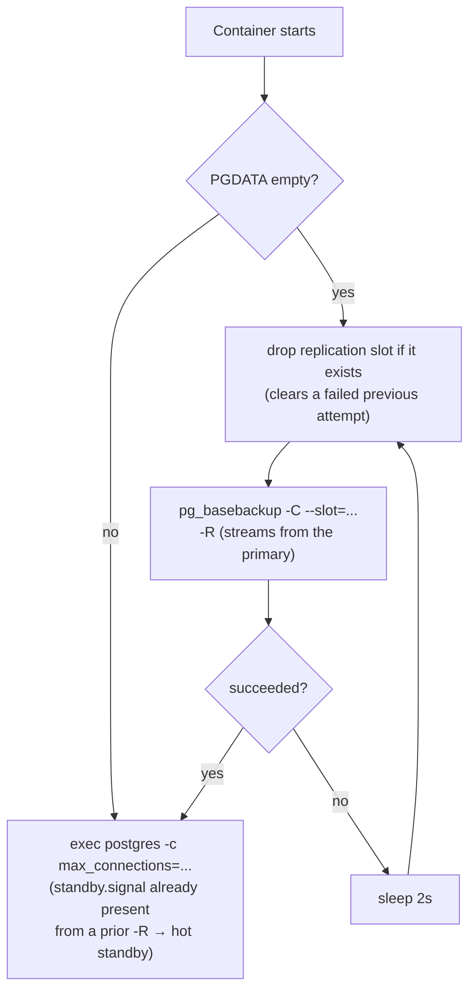

## What it is

A streaming (physical) replica of the whole Postgres cluster — bootstraps from the primary via
`pg_basebackup`, then runs as an ordinary hot standby. `postgres-replica2` is its symmetric twin
(same role, own replication slot) — this doc covers both.

## What it solves

See [Read-replica routing](pattern:read-replica-routing).

## How it works

Postgres replicates the **whole cluster** (all three logical databases together, not
per-database — physical replication works at the cluster level) via continuous WAL streaming from
the primary. [PgCat](node:pgcat) is what decides whether a given query ends up here at all; this
node has no say in that.

## How it's implemented here

```bash
# sandbox/infra/postgres/replica-entrypoint.sh:17
if [ -z "$(ls -A "$PGDATA" 2>/dev/null)" ]; then
  while true; do
    psql -h postgres -p 5432 -U replicator -d postgres \
      -tAc "SELECT pg_drop_replication_slot('${REPLICA_SLOT_NAME}')" >/dev/null 2>&1 || true
    if pg_basebackup -h postgres -p 5432 -D "$PGDATA" -U replicator -Fp -Xs -P -R \
         -C --slot="${REPLICA_SLOT_NAME}"; then
      break
    fi
    sleep 2
  done
fi
```



`-C --slot` creates a **replication slot** on the primary and (combined with `-R`) writes it into
this replica's recovery config, so every later reconnection uses the same slot too — not just the
initial backup. The slot is what lets the primary know exactly how much WAL this specific replica
still needs, instead of guessing with a size-based buffer. The slot is dropped before every retry
attempt (ignoring failure — it may not exist yet) so a backup that failed partway through doesn't
leave a stale slot blocking the next attempt with "already exists".

Each replica needs its own `max_connections` passed through explicitly (`POSTGRES_MAX_CONNECTIONS`
env var, same value as the primary) — Postgres refuses to start hot standby if a replica's value is
lower than whatever the primary is currently running with.

## How to use it

A standing "Read replicas (Postgres)" toggle in the architecture-map UI's Topology panel
starts/stops `postgres-replica1`/`postgres-replica2` together and keeps [PgCat](node:pgcat)'s own
`servers` list in sync around it — OFF drops both from pgcat's config and stops both containers (in
that order: config change, then stop); ON is the mirror image. It only ever stops the containers,
never removes them, so their volume and permanent replication slot (see "How it's implemented
here" above) survive — a later ON resumes WAL streaming from where it left off instead of a fresh
`pg_basebackup`. Equivalent API: `POST /api/infra/postgres-replicas {"enabled": bool}`
(control-api). Always both replicas as a pair — there's no way to toggle just one of them through
this control.

## Pitfalls

- 🐛 [Replica healthchecks proved the process was up, not that replication was happening](pitfall:postgres-replica-healthcheck-doesnt-verify-streaming)
  (infrastructure-bug) — fixed
- 🐛 [No replication slot meant a disconnected replica could never catch back up](pitfall:postgres-replica-no-replication-slot)
  (infrastructure-bug) — fixed
- ⚠️ [Rewriting a config file a process polls on a timer is not the same as that process having read it](pitfall:pgcat-toml-rewrite-not-reloaded-immediately)
  (race-condition) — fixed

## Relatives

### Nodes

- [PgCat](node:pgcat)

### Patterns

- [Read-replica routing](pattern:read-replica-routing)
- [High availability & failover](pattern:high-availability-failover) — same replication
  mechanism, but these two pitfalls are the ones actually found while building it
