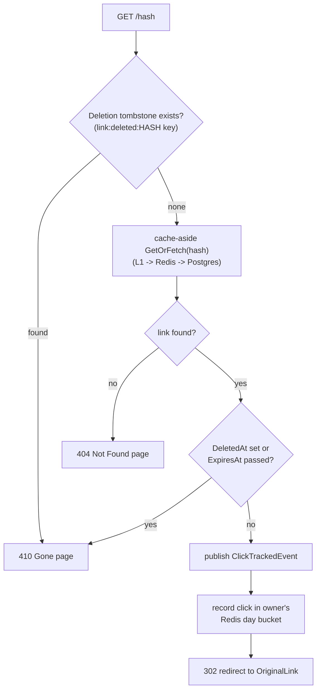

## What it is

An ASP.NET Core Web API — resolves a short hash back to its original URL and redirects. The
highest-QPS endpoint in the whole system: created once per link, hit once per click.

## What it solves

The whole point of a link shortener is this one request being fast and cheap, however many times
it's called — see [Caching](pattern:caching) for why that means avoiding Postgres on the common
case.

## How it works

`GET /{hash}`: a Redis "deleted" tombstone check first, then cache-aside lookup
([Caching](pattern:caching), including the in-process L1 tier and negative caching in front of
Redis) with a live `DeletedAt`/`ExpiresAt` check on what comes back, then
(if still alive) publish a `ClickTrackedEvent` ([Async messaging](pattern:async-messaging)),
record the click in the owner's Redis day bucket, then a 302. A dead hash - whichever check caught
it - gets an HTML "gone" (`410`) or "not found" (`404`) page instead, not this API's usual JSON
`ProblemDetails` shape; see below for why that's a deliberately different response type.



## How it's implemented here

```csharp
// src/backend/Services/RedirectApi/Controllers/RedirectController.cs:46, RedirectToOrigin (trimmed -
// the request-budget token wrapping this actually runs under is covered separately below)
var marker = await _deletionMarkers.GetAsync(hash, budgetToken);
if (marker is not null) return GonePage(marker.Reason, marker.DeletedAt);

var link = await _cache.GetOrFetch(hash, fetchFromDb: Fetch, budgetToken);
if (link is null) return NotFoundPage();

if (link.DeletedAt is not null || (link.ExpiresAt is { } expiresAt && expiresAt <= DateTime.UtcNow))
{
    return GonePage(/* ... */);
}

var clickEvent = new ClickTrackedEvent { Id = Guid.NewGuid(), Hash = hash, /* ... */ };
await _dispatcher.DispatchAsync(clickEvent, Topics.ClickTracked, cancellationToken);

// Redis ZINCRBY into the owner's day bucket - no-op for anonymous links, never touches Postgres
await _clickCounter.RecordClickAsync(hash, link.UserId, clickEvent.ClickedAt, cancellationToken);

return Redirect(link.OriginalLink); // 302, never permanent - the target can change
```

The tombstone check (`ILinkDeletionMarkerStore.GetAsync`, Redis key `link:deleted:{hash}` -
deliberately separate from the `link:{hash}` cache-aside entry) runs before anything else: once a
hash is tombstoned, nothing else about the record matters for this decision, and it skips a Redis
AND a potential Postgres round trip for a hash already known dead. It isn't the *only* check,
though - that tombstone is only guaranteed to exist once
[ShortenerService](node:shortener-service)'s consumer or sweep job has actually confirmed it, and
the sweep runs once a minute, so the live `DeletedAt`/`ExpiresAt` check on the `Link` row itself
closes the window a tombstone-only check would otherwise leave open for up to that whole minute.

The gone/not-found pages are plain inline HTML (`ContentResult`, explicit status code), the first
HTML response anywhere in `src/backend` - a short-link redirect is followed by a browser's
top-level navigation, not a script reading JSON, so a human needs something readable here instead
of the usual `{type,title,status,detail}` shape. Written with the body already populated
specifically so `UseApiExceptionHandling`'s `UseStatusCodePages` callback - which only fires on a
response that's still empty - leaves it alone; verified against the running stack, not just
assumed from the ASP.NET Core docs.

Two separate consumers process `ClickTrackedEvent` downstream, for different reasons:
`ShortenerService` maintains `Links.ClickCount` as a fast display counter, `TrafficService` writes
the real audit trail (Postgres `Clicks` + Mongo click metadata) — see
[ShortenerService](node:shortener-service)'s Pitfalls for a race this split surfaced.

`IClickCounterService` writes each owned click into a per-user, per-day sorted set
(`clicks:user:{userId}:day:{YYYYMMDD}`). ReportingApi reads those buckets for the live top-links
view. The request-response cache (`link:{hash}`) is a separate key on the same Redis instance,
with a different purpose: it's disposable, the day buckets are a rolling aggregate.

### Graceful shutdown

Same `AddGracefulShutdown()`/`stop_grace_period: 20s` pairing as [LinkApi](node:link-api) — see
that node's doc and [this pitfall](pitfall:shutdown-timeout-is-one-shared-sequential-clock) for the
mechanism. A replica scaled down or stopped mid-redirect finishes its in-flight response instead of
being killed before the 302 goes out.

### Request budget + load shedding

The lookup phase above — the tombstone check plus the cache-or-DB fetch — runs under a single
configurable deadline (`Redirect:RequestBudgetMs`, default 2000ms): a
`CancellationTokenSource.CreateLinkedTokenSource(cancellationToken)` wraps the caller's own
request-aborted token, then `CancelAfter(_requestBudget)` arms a timer on the linked source. If
that phase doesn't finish within budget, the request sheds immediately with `503 Service
Unavailable` + `Retry-After: 1` instead of waiting out however slow Redis/Postgres currently are.

**The budget deliberately does not cover click-tracking dispatch or the click counter** — by the
time the code reaches those two calls, the redirect target has already been decided, and a
deadline that could interrupt an already-decided side effect would turn "shed an overloaded
request" into "silently drop a click that should have been recorded." They use the caller's own
token directly, never the budget-linked one. This is the single most important thing to know about
this feature: a reader expecting a "request-wide deadline" to cover everything after the lookup
too would be wrong.

No EF `CommandTimeout` is layered on top of the cancellation token for the Postgres fallback fetch
— the project's `EnableRetryOnFailure` execution strategy would otherwise treat a raw
command-timeout as a transient fault worth retrying, silently extending a request past its budget
instead of shedding it on time.

This isn't wired into `control-api`/`architecture-map` — it's a correctness/resilience property of
the hot path, not a live on/off pattern meant for A/B comparison in the UI. See this node's
Pitfalls for two subtle bugs this budget's first version got wrong around cancellation.

### Rate limiting

The same shared `RedisRateLimitFilter` [AuthApi](node:auth-api) uses also guards
`RedirectToOrigin`, keyed purely by client IP — **not** `userId`, even though a link has a known
owner: `RedirectToOrigin` never authenticates its caller (a short-link click is an anonymous
browser navigation), and the `userId` a `ClickTrackedEvent` carries is the *link's owner*, set when
the link was created, not whoever is clicking it now. There was never a caller `userId` available
on this path to key on. Default 600 requests/60s, overridable without a rebuild via
`REDIRECT_RATE_LIMIT_PERMIT`/`REDIRECT_RATE_LIMIT_WINDOW_SECONDS` in `docker-compose.yml` — useful
for demoing a live `429` on purpose, since the default is sized high enough that normal load-test
traffic through nginx rarely trips it on its own.

Unlike AuthApi, **RedirectApi fails open on a Redis outage** — Redis is already a critical
dependency on this exact path (the link cache, the deletion-marker lookup above), and this
project's established rule for this hot path is that a Redis outage degrades gracefully rather
than blocking it; adding a third reason for Redis to block redirects would contradict that
existing pattern.

This feature is also what added `app.UseForwardedHeaders(...)` to this service for the first time
(`ForwardedHeaders.XForwardedFor`, `ForwardLimit = 1`, placed first in the pipeline, before
anything reads `RemoteIpAddress`) — needed because every request here already arrives via `nginx`,
so the real client address is in `X-Forwarded-For`, not the socket peer. `ForwardLimit = 1` trusts
only the *last* entry in that header; since nginx's own `$proxy_add_x_forwarded_for` always appends
the real socket peer to whatever a client sent, trusting only the last hop means a client that
prepends fake entries before nginx ever sees them gets ignored, not trusted. Safe specifically
because this service has no host port mapping — nginx is the only way in, so there's no second,
unproxied entry point a spoofed header could abuse.

## Pitfalls

- 🐛 [Every publish opened and declared a brand-new AMQP channel](pitfall:rabbitmq-publisher-unpooled-channel-hot-path)
  (cpu-leak) — fixed
- ⚠️ [Click counter incremented before the dispatch it should depend on](pitfall:click-counter-incremented-before-dispatch)
  (resilience-gap) — fixed
- ⚠️ [Point-to-point RPC dispatch silently breaks pub/sub fan-out to the other consumers](pitfall:sync-dispatch-breaks-pubsub-fanout)
  (architecture-bug) — known limitation
- ⚠️ [RabbitMQ's publisher stack started even when the active transport doesn't use it](pitfall:rabbitmq-publisher-started-regardless-of-messaging-mode)
  (performance) — fixed
- 🐛 [A read immediately after a write can land on a lagging replica](pitfall:pgcat-read-your-writes-race)
  (race-condition) — fixed; this node's cache-first read is what the fix relies on
- 🐛 [Three services ran identical caching code against three disjoint Redis keyspaces](pitfall:redis-instance-name-breaks-cross-service-cache-sharing)
  (coupling) — fixed; this node's own cache reads were invisible to LinkApi/ShortenerService's writes
- ⚠️ [Fail-open that only caught RedisException let timeouts fail the redirect](pitfall:fail-open-catch-too-narrow)
  (resilience-gap) — fixed
- ⚠️ [A fail-open tombstone write is not enough on its own to invalidate an already-cached entity](pitfall:deletion-tombstone-alone-leaves-stale-cache-entry)
  (resilience-gap) — fixed; this node's cache-hit read path is the one that stays fooled if the fix fails
- ⚠️ [`HostOptions.ShutdownTimeout` is one shared clock, not a budget per hosted service](pitfall:shutdown-timeout-is-one-shared-sequential-clock)
  (config-tuning) — fixed
- ⚠️ [A per-request deadline's catch filter has to check the caller's own token, not its own local one](pitfall:request-budget-coalesced-fetch-wrong-cancellation-check)
  (concurrency) — fixed
- ⚠️ [Accepting a CancellationToken parameter doesn't mean the call underneath actually honors it](pitfall:redis-call-cancellation-token-silently-ignored)
  (resilience-gap) — fixed

## Relatives

### Nodes

- [LinkApi](node:link-api) — the hashes this node resolves come from there
- [ShortenerService](node:shortener-service) — see the click-tracking split note above
- [TrafficService](node:traffic-service) — see the click-tracking split note above
- [Redis](node:redis-master) — cache, per-user click day buckets, and the rate limiter above
- [RabbitMQ](node:rabbitmq) — carries `ClickTrackedEvent`
- [AuthApi](node:auth-api) — shares the same `RedisRateLimitFilter` mechanics, opposite
  fail-open/fail-closed choice

### Patterns

- [Caching](pattern:caching)
- [Async messaging](pattern:async-messaging)
