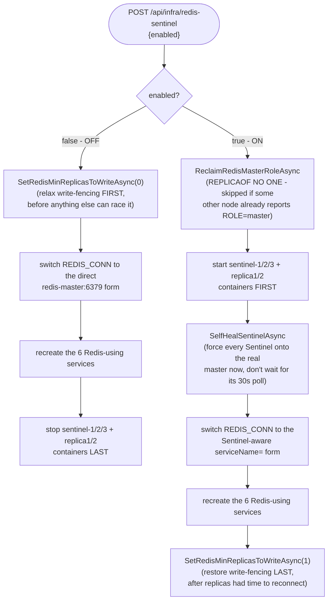

## What it is

One of 3 [Redis](https://redis.io/docs/latest/operate/oss_and_stack/management/sentinel/)
Sentinel processes that monitor [Redis (master)](node:redis-master) and its replicas and vote on
failover. `redis-sentinel-2`/`-3` are symmetric peers — this doc covers all three; the point of
running 3 is quorum (tolerating 1-2 being unreachable without false-triggering a failover).

## What it solves

See [High availability & failover](pattern:high-availability-failover).

## How it works

Sentinel is a separate process from the Redis instances it watches — it never serves application
data itself. It (1) monitors master and replica health, (2) agrees with the other Sentinels
(quorum) on whether the master is really down, not just briefly slow, and (3) issues the promotion
(`REPLICAOF NO ONE` on the chosen replica) when quorum agrees.

The app never queries Sentinel for data — `StackExchange.Redis`'s Sentinel-aware client asks it
"who is `mymaster` right now" and connects directly to whichever node it names, re-asking
automatically after a connection failure.

## How it's implemented here

```
# ConnectionStrings__Redis, e.g. docker-compose.yml:843
redis-sentinel-1:26379,redis-sentinel-2:26379,redis-sentinel-3:26379,serviceName=mymaster
```

The `serviceName=` syntax is `StackExchange.Redis`'s own Sentinel-aware connection-string form —
`ConfigurationOptions.Parse` recognizes it and has `ConnectionMultiplexer.Connect` ask Sentinel for
`mymaster`'s address instead of dialing a fixed host directly. `RedisExtensions.AddRedisMultiplexer`
(`src/backend/Shared/Infrastructure/RedisExtensions.cs:74`) is the raw-multiplexer path that parses
it directly; `AddRedisDistributedCache`'s `AddStackExchangeRedisCache` parses the same connection
string through the same underlying library for its own `IDistributedCache` path. The client talks
to all 3 Sentinel addresses, not one — any single
Sentinel being briefly down doesn't affect the app's ability to find the current master. Sentinel's
own config (`sentinel monitor mymaster <ip> 6379 2`, quorum 2 of 3) is generated at container start,
not bind-mounted read-only, because Sentinel rewrites its own config file on every state change (a
failover, a newly-discovered replica) — see this node's Pitfalls for why that generation step
turned out to be non-trivial.

## Standing toggle

A "Redis Sentinel (HA)" row, nested under [Redis (master)](node:redis-master)'s own toggle in the
Topology panel, starts/stops all 3 Sentinels and both Redis replicas together and recreates the 6
Redis-using services onto the matching connection-string form (Sentinel-aware vs. direct
`redis-master:6379`). Only legal while Redis itself is on. OFF recreates the services onto the
direct connection string *before* stopping the HA containers ("safe state first"); ON is the mirror
image. Equivalent API: `POST /api/infra/redis-sentinel {"enabled": bool}`.

Three real, live-discovered quirks this toggle has to carry, beyond "containers running + connection
string":

1. **`min-replicas-to-write`** — see
   [this node's/`redis-master`'s own pitfall](pitfall:redis-min-replicas-to-write-not-resynced-on-restart)
   for the full story; this toggle relaxes it to `0` before the OFF path's recreate, and restores it
   to `1` after the ON path's containers are back up.
2. **Stale `sentinel.conf` surviving a restart.** Once Sentinel's own config file has ever carried a
   `# Generated by CONFIG REWRITE` marker, its inline compose `command:` entrypoint never re-derives
   `mymaster`'s address via DNS again on a later restart — confirmed live, a Sentinel restart with
   stale config can fail over onto a now-dead address and tell the real `redis-master` to demote
   itself to replica. This toggle is the first thing in the stack's *normal* lifecycle that ever
   restarts the Sentinel containers (previously only a full stack restart or deliberate chaos
   testing did). Fixed by reclaiming `redis-master`'s role (`REPLICAOF NO ONE`, a no-op if already
   master) before the HA containers even start, then calling the pre-existing self-heal routine
   immediately on the ON path instead of waiting for its regular 30-second poll.
3. **Exit codes on the exec calls** — the `min-replicas-to-write` fix's own exec call initially used
   a helper that never checked the exit code, so a `redis-cli` call issued before `redis-master` had
   finished its own ~10-second Sentinel-discovery startup delay looked like a successful `CONFIG SET`
   in the logs while the value silently stayed unchanged — see the pitfall linked above for the fix.

The ON and OFF paths are deliberate mirror images, each ordered so no service or container is ever
left pointed at something that's about to disappear:



## Known trade-off, not a bug: a plain restart can resurrect stale topology memory

Not specific to the Sentinel toggle above - any `docker compose up` can hit this, including the
very first one after opening Docker Desktop with no containers running yet. Three Sentinel
instances only protect against *Sentinel itself* disagreeing with *Sentinel itself* (the quorum
vote in "How it works" above); they do nothing to stop two completely separate memories - this
node's own `sentinel.conf` (rewritten on every failover, persisted in a named volume, never
overwritten again once it carries a `CONFIG REWRITE` marker) and a Redis data node's own
`STATE_FILE` (its last Sentinel-confirmed role, persisted the same way) - from each independently
resurrecting on a restart and pointing at two different, no-longer-accurate pictures of who's
master, if either volume survived from an earlier session. `redis-master.md`'s own split-brain
fencing (`min-replicas-to-write`) limits the damage (an isolated node refuses writes) but doesn't
prevent the two-masters state itself; [this toggle's own reclaim-ordering
fix](pitfall:sentinel-toggle-reclaim-causes-two-masters) prevents one specific trigger (the ON path
manufacturing a second master) but not this one, since this one isn't triggered by the toggle at
all - it's any restart, the toggle included only incidentally.

Hostname-based monitoring (`resolve-hostnames`/`announce-hostnames`, so Sentinel re-resolves
`redis-master` by DNS instead of caching a frozen IP) looks like the obvious textbook fix and was
tried - and reverted, live-verified: Docker's embedded DNS doesn't return a fresh IP when a
container dies, it stops resolving the name at all, and Sentinel's hostname-resolution path
blocking on that kept re-triggering its own self-protective "tilt mode" every cycle, so failover
never completed. IP-based monitoring (what's actually running - see `sentinel.conf`'s own comment)
hits a clean, fast "connection refused" instead, which is why it was kept despite the staleness
risk above.

The only thing that actually guarantees a blank slate for both memories together is
`sandbox/scripts/stop-stack.ps1 -Wipe` (`docker compose down -v`) - it drops every Sentinel and
data-node volume along with Postgres's, not just Postgres's. A plain restart's own "no Sentinel
container reachable yet" log line (`redis-node-entrypoint.sh`) only promises that no Sentinel
answered DNS just now, never that either side's persisted memory is actually empty.

## Pitfalls

- 🐛 [Sentinel's own hostname resolver failed even though every other tool on the same container could resolve it](pitfall:redis-sentinel-resolver-fails-despite-dns-working)
  (infrastructure-bug) — fixed
- 🐛 [Only the Redis master asked Sentinel who's in charge before rejoining - the replicas didn't](pitfall:redis-replica-ignores-sentinel-on-rejoin)
  (architecture-bug) — fixed
- ⚠️ [A CLI flag baked in on every container start can quietly undo a runtime CONFIG SET](pitfall:redis-min-replicas-to-write-not-resynced-on-restart)
  (resilience-gap) — fixed
- ⚠️ [Reclaiming a node back to "master" is only safe if nothing else already holds that role](pitfall:sentinel-toggle-reclaim-causes-two-masters)
  (resilience-gap) — fixed
- ⚠️ [A control-plane process's in-memory cache of "what's currently toggled" has no source of truth once it restarts](pitfall:infra-toggle-state-resets-on-restart-desyncs-live-containers)
  (architecture-bug) — fixed; cited here for the "Redis back in Sentinel-form while Sentinel is
  stopped" failure scenario

## Relatives

### Nodes

- [Redis (master)](node:redis-master)

### Patterns

- [High availability & failover](pattern:high-availability-failover)
