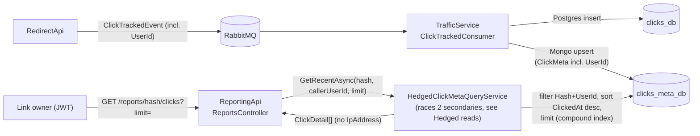
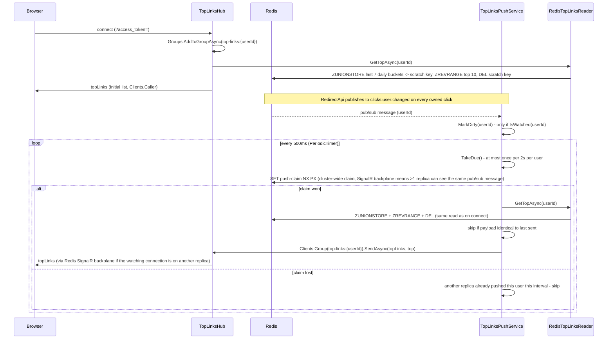

## What it is

An ASP.NET Core Web API with two unrelated jobs bundled into one service: a read-only query
endpoint over ClickHouse (the CQRS read side — see [CQRS fan-out](pattern:cqrs-fanout)), and a
SignalR hub that pushes each user's live top-10-links list over a WebSocket. Every endpoint and the
hub both require a valid JWT — unlike LinkApi/RedirectApi's optional-token posture, there's no
anonymous path through this service at all, since both features expose per-account data.

## What it solves

**Reports.** `reports_db` in ClickHouse is a second, independent copy of click data, written by
[ReportingService](node:reporting-service) specifically so aggregate queries (by day/country/
device/browser) run against a columnar store built for that, instead of competing with
[TrafficService](node:traffic-service)'s own Postgres/Mongo writes on the same data. ReportingApi
is the only thing that reads it.

**Live top links.** A registered user wants to see their own top-10 links by clicks over the last 7
days, updating as clicks happen — without polling. [RedirectApi](node:redirect-api) writes every
owned click into Redis; ReportingApi reads the rolling window back and pushes it to any open
dashboard the instant a watched user's list actually changes. A *global* top list would leak other
users' link stats, so this is deliberately per-user only.

## How it works

**Reports:** `GET /reports/{hash}/summary` validates the hash format, then runs one raw
parameterized SQL query against ClickHouse and returns the aggregate. No ORM here on purpose — this
is the one place in the project meant to show what a real columnar OLAP query looks like, not
hidden behind a query builder.

**Owner-scoped reports.** The endpoint only ever returns data for hashes the caller owns.
`ClickHouseClickFactQueryService.GetSummaryAsync` runs the 4 bucket queries filtered
`AND user_id = callerId` and nothing else — that filter is what actually keeps someone else's click
data out of the response. The owner travels with the click itself (`RedirectController` already
holds `link.UserId` when it publishes `ClickTrackedEvent`; `ClickTrackedConsumer` carries it into
`ClickFact.UserId` — no extra lookup anywhere in the chain), so this is additive, not a new network
hop.

```csharp
// src/backend/Shared/Infrastructure/ClickHouseClickFactQueryService.cs:28, GetSummaryAsync (trimmed)
var byDayTask = RunBucketsAsync(
    "SELECT toString(toDate(clicked_at)) AS k, count() AS c FROM clicks " +
    "WHERE hash = {hash:String} AND user_id = toUUID({userId:String}) GROUP BY k ORDER BY k",
    hash, callerUserId, cancellationToken);
var byCountryTask = RunTopBucketsAsync("country", hash, callerUserId, cancellationToken);
var byDeviceTask = RunTopBucketsAsync("device_type", hash, callerUserId, cancellationToken);
var byBrowserTask = RunTopBucketsAsync("browser", hash, callerUserId, cancellationToken);
await Task.WhenAll(byDayTask, byCountryTask, byDeviceTask, byBrowserTask);
```

4 bucket queries run concurrently via `Task.WhenAll`, not sequentially — see this node's Pitfalls
for the fix that made that true (it used to be 5 queries, sequential). `{hash:String}`/
`{userId:String}` are the `ClickHouse.Driver` NuGet package's own server-side parameter
placeholders, resolved by ClickHouse itself — never string-interpolated.

**Always `200`, never a leak oracle — found in review, not designed in from the start.** An earlier
version ran a 5th scalar query (`count() WHERE hash = ? AND user_id IS NOT NULL AND user_id !=
callerId`) to tell "owned by someone else" apart from "doesn't exist", turning the former into a
`404` and leaving the latter (and "owned, zero clicks yet") as an ordinary all-zero `200`. That was
itself the privacy leak it was meant to prevent: a caller could tell "this hash exists and belongs
to someone else" apart from "this hash doesn't exist" by which status code came back. The fix
removed that branch entirely — `GetSummaryAsync` never returns `null`, so a hash that doesn't exist,
a hash the caller genuinely owns with zero clicks, a hash owned by someone else, and an
anonymously-created link (`user_id IS NULL` on every one of its click rows, which never matches any
caller's filter either) are all indistinguishable from the outside: every one of them gets the same
all-zero `200`. An anonymous link still has no reporting view for anyone, not a shared public one
either — it's just one more case that quietly falls out of the same filter instead of a case this
endpoint has to special-case.

**Raw click detail (`GET /reports/{hash}/clicks`) — the "flexible document" counterpart to the
ClickHouse aggregate.** `/summary` answers "how many clicks, bucketed by day/country/device/
browser" but can't answer "show me the actual rows" — a link owner debugging "why does my summary
say 40 clicks from Germany" has no way to see the individual clicks (browser, referrer, exact city)
behind that number from `/summary` alone. [TrafficService](node:traffic-service) already wrote
exactly that detail into `clicks_meta_db` (Mongo) on every click, but nothing ever read it back
until this endpoint — Mongo was write-only in this project before it. The project already had a
precedent for "one database, two interfaces, one per direction" with ClickHouse
(`IClickFactStore`/`IClickFactQueryService`); this endpoint applies the identical shape to Mongo:
`IClickMetaStore` (TrafficService, write side) keeps `SaveManyAsync`, and the new
`IClickMetaQueryService` (ReportingApi only, via `MongoClickMetaQueryService`) adds
`GetRecentAsync(hash, callerUserId, limit, ct)`. The two stores are genuinely independent Mongo/
ClickHouse writers fed from the same `ClickTrackedEvent` — they can drift apart transiently (one
consumer down, the other up), the same CQRS-fan-out caveat that already applies to the rest of this
pipeline.

Owner scoping follows the exact same posture as `/summary`: the query filters on `Hash == hash AND
UserId == callerUserId` (`ClickTrackedEvent.UserId` now flows into Mongo's `ClickMeta` too, not
just ClickHouse's `ClickFact`), backed by a compound index `(Hash asc, UserId asc, ClickedAt desc)`
— equality fields before the sort field, so the filter+sort the query actually runs doesn't fall
back to a full collection scan. A hash that doesn't exist, belongs to someone else, or just has zero
clicks all return the same `200` with an empty/partial array; there's no `404` branch, for the same
reason `/summary` has none. `limit` is optional (default `20`, clamped into `[1, 100]`, never
rejected with a `400`). The returned `ClickDetail` DTO deliberately omits `IpAddress` — the
underlying Mongo document keeps the raw IP (TrafficService needs it for geo-IP resolution), but
handing a visitor's IP to the link owner through this API is a PII exposure this feature has no need
to take on. Pre-existing Mongo documents from before this endpoint shipped have no `UserId` (the
field didn't exist yet) and so can never show up here for any real caller — invisible, not errored,
the same backward-compatible shape `ClickFact.UserId` already has on the ClickHouse side. The
product dashboard (`src/frontend/app`, `DashboardPage`'s "Recent clicks" panel) now consumes this
endpoint, fetched independently of the existing ClickHouse-backed "Stats" panel — both panels can be
on screen at once and can disagree in liveness, since they're fed by two separate consumers
(ReportingService→ClickHouse, TrafficService→Mongo) of the same `ClickTrackedEvent`.

The query itself doesn't go straight to the replica set's driver-picked node: `GetRecentAsync` is
actually served by `HedgedClickMetaQueryService`, which races the same query against two of `rs0`'s
current secondaries and takes whichever answers first, to cut tail latency on a slow replica — see
[Hedged reads](pattern:hedged-reads) for the full mechanism (the hedge-delay race, live primary
detection, the `mongo-hedge-delay` control dial). `GuidRepresentation` is also worth knowing about
here: `ClickMeta.UserId` (the field this query filters on) needs its own
`[BsonGuidRepresentation(...)]` for the driver to serialize it at all — see this node's Pitfalls.



**Live top links**, three pieces working together:

1. **`TopLinksHub`** (`/hub/top-links`, SignalR) — on connect, adds the caller to a per-user group
   and immediately sends the current list (so the dashboard isn't empty until the next click); on
   disconnect, tells the scheduler below to forget this user once nobody's left watching them.
   Browsers can't set headers on a WebSocket, so the JWT arrives as `?access_token=`, read only for
   `/hub` paths (see `WebDefaults`).
2. **`TopLinksPushService`** (background service) — subscribes to Redis's `clicks:user:changed`
   pub/sub channel (`RedirectApi` publishes to it on every owned click) and marks the affected user
   dirty, but only if someone's actually watching them. A `PeriodicTimer` checks for due users every
   500ms and pushes at most once per 2 seconds per user, skipping a push whose payload is byte-for-
   byte identical to the last one sent — so a burst of clicks on the same link coalesces into one
   update, not one per click.
3. **`RedisTopLinksReader`** — on each push (or on connect), `ZUNIONSTORE`s the user's last 7 daily
   sorted-set buckets (written by `RedisClickCounterService` in RedirectApi) into a throwaway
   scratch key, reads the top 10 by score, and deletes the scratch key. A true sliding window,
   recomputed from the buckets on every read — not a snapshot that resets at midnight.



## How it's implemented here

```csharp
// src/backend/Services/ReportingApi/Realtime/TopLinksPushService.cs:96
internal async Task PushAsync(Guid userId, CancellationToken cancellationToken)
{
    // Cluster-wide claim, not just this replica's own IsUnchanged/MinPushInterval throttle - see
    // "Scaling and the SignalR backplane" below for why a per-process throttle alone isn't enough
    // once more than one replica exists.
    if (!await TryClaimPushAsync(userId, cancellationToken)) return;

    var top = await _reader.GetTopAsync(userId, DateTime.UtcNow, cancellationToken);
    var payload = JsonSerializer.Serialize(top);
    if (_scheduler.IsUnchanged(userId, payload)) return;

    _scheduler.RecordPayload(userId, payload);
    // Re-checked after recording - a disconnect that landed during the query above would
    // otherwise have its Forget() run before RecordPayload re-added this user's payload.
    if (!_subscriptions.IsWatched(userId))
    {
        _scheduler.Forget(userId);
        return;
    }

    await _hub.Clients.Group(TopLinksHub.GroupFor(userId))
        .SendAsync(TopLinksHub.TopLinksMethod, top, cancellationToken);
}
```

Both the reports endpoints and the top-links hub share one service process and one Redis/
ClickHouse connection pool each, but are otherwise independent — a ClickHouse outage doesn't affect
the live push path, and (since the resilience fixes below) a Redis outage doesn't take down the
report endpoints either.

### Scaling and the SignalR backplane

This is the one HTTP-facing service that could never be scaled past one replica for a while — not
because of anything SignalR-specific at first, but because it published a fixed host port (like
`AuthApi` still does) instead of sitting behind nginx, so Compose would simply refuse a second
replica. Fronting it with nginx (a `reporting_api_upstream`, same shape as
`link_api_upstream`/`redirect_api_upstream`) made scaling mechanically possible, and immediately
exposed the real SignalR-specific problem: a hub connection negotiates over *two* separate HTTP
requests (`POST .../negotiate` allocates a `connectionId` server-side, then the actual
WebSocket/SSE/long-polling upgrade has to reach that *same* replica) — plain round-robin has no
reason to send both to the same backend, so every connection failed with SignalR's own
"No Connection with that ID" error. Sticky-by-client routing (`hash $remote_addr consistent;` — not
plain `ip_hash`, which rehashes on every peer-count change; see this node's Pitfalls) fixes that.

Sticky-by-IP alone already self-heals the common case (one user, one source IP, always routed to
the same replica). The remaining gap — one user open on two devices on genuinely different
networks, where each device's connection can land on a *different* replica — is what the SignalR
Redis backplane (`AddSignalR().AddStackExchangeRedis(...)`, reusing the same Redis connection
string every other client in this service already depends on) actually closes: it lets a push
decided on one replica reach a connection living on another. Wiring that in exposed a second real
bug — see this node's Pitfalls for both it and the nginx keepalive/hashing issues scaling surfaced.

## Pitfalls

- 🐛 [A CORS/credentials mismatch silently blocked the SignalR negotiate request](pitfall:signalr-cors-credentials-mismatch-blocks-negotiate)
  (infrastructure-bug) — fixed
- 🐛 [Per-user push state that never got evicted](pitfall:push-service-per-user-state-never-evicted)
  (memory-leak) — fixed
- 🐛 [A fail-open catch that only caught RedisException let timeouts fail the redirect](pitfall:fail-open-catch-too-narrow)
  (resilience-gap) — fixed
- 🐛 [A Redis blip at boot crashed the whole API](pitfall:redis-multiplexer-abort-on-connect-fail-crashes-host)
  (resilience-gap) — fixed
- 🐛 [A real-time connection hook gave up permanently after one bad start](pitfall:top-links-hook-gives-up-after-failed-connect)
  (resilience-gap) — fixed
- 🐛 [Per-process push state plus a cross-replica fan-out backplane means every watching replica fires independently](pitfall:signalr-backplane-double-push-no-cluster-claim)
  (architecture-bug) — fixed
- 🐛 [A WebSocket-upgrade header pattern applied to a whole location also closes every plain REST connection on it](pitfall:nginx-websocket-upgrade-headers-kill-rest-keepalive)
  (connection-pooling) — fixed
- ⚠️ [`ip_hash` rehashes modulo the live peer count, not a stable ring — fragile on an upstream meant to be scaled live](pitfall:nginx-ip-hash-rehashes-on-peer-count-change)
  (config-tuning) — fixed
- 🐛 [A ClickHouse client registered as a singleton still opened a fresh HttpClient on every call](pitfall:clickhouse-unpooled-httpclient-per-call)
  (connection-pooling) — fixed
- 🐛 [ClickHouse's healthcheck could pass before its init script finished creating the table](pitfall:clickhouse-healthcheck-passes-before-init-script-completes)
  (infrastructure-bug) — fixed
- 🐛 [A reporting query ran five independent round trips sequentially, one of them redundant](pitfall:clickhouse-summary-query-sequential-and-redundant)
  (db-query) — fixed
- 🐛 [A `Guid` field in a Mongo document needs its own `BsonGuidRepresentation`](pitfall:mongo-guid-field-needs-bsonguidrepresentation)
  (db-query) — fixed
- ⚠️ [Disposing a `CancellationTokenSource` the instant it's "no longer needed," not once its task is actually done](pitfall:cts-disposed-before-task-finishes)
  (concurrency) — fixed
- ⚠️ [Assuming the first host in a replica-set connection string is always the primary](pitfall:mongo-hedge-static-primary-assumption)
  (architecture-bug) — fixed

## Relatives

### Nodes

- [ReportingService](node:reporting-service) — writes what the reports endpoints read
- [ClickHouse](node:clickhouse)
- [TrafficService](node:traffic-service) — writes the Mongo `ClickMeta` documents the `/clicks` endpoint reads
- [Mongo](node:mongo1)
- [RedirectApi](node:redirect-api) — writes the Redis buckets this node's push path reads
- [Redis (master)](node:redis-master)

### Patterns

- [CQRS fan-out](pattern:cqrs-fanout)
- [Distributed locking: Redis claims](pattern:distributed-locking-redis) — the cross-replica push
  claim `TopLinksPushService` takes before pushing
- [Hedged reads](pattern:hedged-reads) — the `/clicks` query races two of Mongo's secondaries
  instead of waiting on whichever one the driver happened to pick
