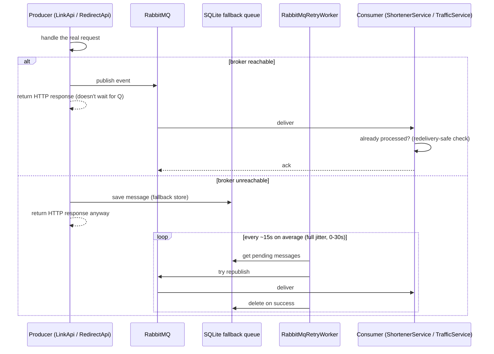

## What it is

Decoupling a request from its side effects via a message broker — [RabbitMQ](node:rabbitmq) here.
A producer publishes an event and returns immediately; one or more consumers process it later,
independently, at their own pace.

## What it solves

`POST /Links` and `GET /{hash}` (redirect) both need to *respond* fast, but each also triggers work
that doesn't need to finish before the caller gets an answer — persisting the link, recording a
click. Making the HTTP response wait on that work would tie the caller's latency to the
consumer's, for no benefit the caller can see.

## How it works

1. The producer ([LinkApi](node:link-api), [RedirectApi](node:redirect-api)) publishes an event
   and returns to its caller without waiting for it to be processed.
2. A consumer ([ShortenerService](node:shortener-service), [TrafficService](node:traffic-service))
   receives the event independently and does the actual work (a database write here).
3. **If the broker is briefly unreachable**, the publish falls back to a local SQLite queue
   instead of failing the request — `RabbitMqRetryWorker` (shared code, used by every publisher)
   polls that queue and republishes once the broker recovers. The HTTP response never waits on
   either path.
4. Consumers are **redelivery-safe** — RabbitMQ's at-least-once delivery means the same event can
   arrive twice; both `LinkCreatedConsumer` and `ClickTrackedConsumer` check whether the row
   already exists before writing, so a redelivery is a no-op rather than a duplicate or an error.



The trade-off: the producer's response no longer means "this is durably recorded" — only "this
was accepted, and will be recorded soon, even across a broker outage." Every consumer in this
project is written to be safe under that weaker guarantee (redelivery-safe, as above); a consumer
that *isn't* redelivery-safe would be a correctness bug the pattern itself doesn't prevent.

## How it's implemented here

`RabbitMqClient`/`RabbitMqPublisher`/`RabbitMqConsumer` (`src/backend/Shared/Infrastructure`) are
shared across every producer/consumer pair in this project — the SQLite fallback queue and
`RabbitMqRetryWorker` are shared code too, not duplicated per service. Exchange/queue/binding
topology is declared by the application itself at connection time, not loaded from
`infra/rabbitmq/definitions.json` (that file is an unused placeholder for a possible future
static-provisioning approach).

Two independent hops exist today: `LinkApi` → `ShortenerService` (`LinkCreatedEvent`) and
`RedirectApi` → `ShortenerService`/`TrafficService` (`ClickTrackedEvent`, consumed by both, for
different reasons — see [ShortenerService](node:shortener-service)).

### Retry polling uses full jitter, not a flat interval

`RabbitMqRetryWorker` used to tick on a flat `PeriodicTimer(TimeSpan.FromSeconds(30))`. If
RabbitMQ goes down and comes back, every replica's 30s tick tends to be correlated (replicas
usually start around the same deploy moment), so every replica's accumulated fallback-queue
backlog would hit the just-recovered broker in the same instant — a retry storm against the exact
piece of infrastructure that's most fragile right after recovering from an outage.

The fix is **full jitter** (in the AWS sense — `random(0, base)`, not `base ± some percent`):

```csharp
// src/backend/Shared/Infrastructure/RabbitMqRetryWorker.cs
internal static TimeSpan NextPollDelay() =>
    TimeSpan.FromSeconds(Random.Shared.NextDouble() * PollIntervalSeconds); // PollIntervalSeconds = 30
```

The delay is re-rolled on every tick (not generated once at startup), so replicas that happened to
start within the same narrow window keep drifting apart over time rather than staying correlated
forever. Full jitter, not a smaller wobble, because a ±10% wobble on a 30s base only spreads ticks
within about ±3s of each other — not enough separation when the real concern is dozens of
replicas retrying a large backlog simultaneously; full jitter spreads ticks uniformly across the
entire `[0, 30s)` range instead.

**Accepted tradeoff: the mean poll interval drops from 30s to 15s** (the mean of `random(0, 30)`).
This is full jitter's known, intentional cost — it decorrelates by sometimes polling much sooner
than 30s, never later than the 30s base. Anything that assumed "the retry worker checks every 30
seconds" (docs, mental models, manual-testing wait times) is now only an upper bound, not a
typical value.

### Why a priority queue (`x-max-priority`) wouldn't help here

A later backlog pass considered RabbitMQ's `x-max-priority` queue feature to protect
`link.created` processing (user-facing) from a `click.tracked` backlog (not) — worked through in
detail against this project's actual queue topology instead of built, because the premise doesn't
hold here.

`x-max-priority` only reorders messages **within one queue** - a higher-priority message jumps the
line ahead of lower-priority ones already waiting in that same queue, nothing more. For that to
help, `link.created` and `click.tracked` would need to compete for position in a *shared* queue.
They don't: every consumer in this project declares and binds its own separately-named queue to
one specific routing key (see "How it's implemented here" above) -
`link.created` only ever reaches `shortener-service.link-created`; `click.tracked` only ever
reaches `shortener-service.click-tracked`, `traffic-service.click-tracked`, and
`reporting-service.click-tracked` - none of which is `shortener-service.link-created`. The two
event types have never shared a queue, not even within `ShortenerService`, which runs separate
consumers (and separate `BasicQos` prefetch) for each. A backlog on any `click.tracked` queue has
no RabbitMQ-level ordering effect on `shortener-service.link-created` at all, so reordering within
a queue - which is all `x-max-priority` does - cannot be what's delaying link creation behind
click processing, because there's no queue where the two are ever waiting together to reorder.

If a real slowdown like that shows up, the actual mechanism would be **process-level resource
contention** - `ShortenerService` runs its `LinkCreatedConsumer` and `ClickTrackedConsumer` as two
separate `BackgroundService`s in the *same* .NET process, sharing CPU and the thread pool. A large
`click.tracked` backlog driving sustained CPU/GC pressure in that process could slow down
`link.created` processing too, but that's contention for a shared process resource, not queue
ordering - a RabbitMQ queue-level feature has no way to express or fix it. (Nothing in this
codebase today binds more than one routing key to a single queue, so there's currently no scenario
at all where `x-max-priority` reordering would have any effect.)

## Pitfalls

- 🐛 [A failed RabbitMQ connection attempt was cached forever](pitfall:rabbitmq-client-connection-never-retried)
  (resilience-gap) — fixed
- 🐛 [Every publish opened and declared a brand-new AMQP channel](pitfall:rabbitmq-publisher-unpooled-channel-hot-path)
  (cpu-leak) — fixed
- 🐛 [The SQLite fallback retry loop could crash itself permanently](pitfall:rabbitmq-retry-worker-crash-loop)
  (resilience-gap) — fixed
- 🐛 [RabbitMQ health check leaked a channel when its own timeout won the race](pitfall:rabbitmq-healthcheck-loser-channel-leak)
  (memory-leak) — fixed
- 🐛 [A dead RabbitMQ connection was never detected once it had connected successfully once](pitfall:rabbitmq-client-stale-connection-reused-forever)
  (resilience-gap) — fixed
- 🐛 [A permanently-failing message looped forever instead of ever giving up](pitfall:rabbitmq-consumer-poison-message-hot-loop)
  (cpu-leak) — fixed
- 🐛 [Scaling link-api/redirect-api made the SQLite fallback queue republish messages twice](pitfall:rabbitmq-fallback-store-shared-file-race)
  (race-condition) — fixed
- 🐛 [The publisher's channel pool could permanently shrink to zero on broker errors](pitfall:rabbitmq-publisher-channel-pool-slot-leaks)
  (connection-pooling) — fixed
- 🐛 [Shutting down the publisher only disposed idle channels, not ones still in flight](pitfall:rabbitmq-publisher-dispose-misses-in-flight-channels)
  (memory-leak) — fixed
- ⚠️ [Click counter incremented before the dispatch it should depend on](pitfall:click-counter-incremented-before-dispatch)
  (resilience-gap) — fixed
- ⚠️ [A deletion tombstone written before the delete event's dispatch is confirmed can outlive a delete that never happened](pitfall:delete-tombstone-written-before-dispatch-confirmed)
  (resilience-gap) — fixed
- ⚠️ [Point-to-point RPC dispatch silently breaks pub/sub fan-out to the other consumers](pitfall:sync-dispatch-breaks-pubsub-fanout)
  (architecture-bug) — known limitation
- ⚠️ [RabbitMQ's publisher stack started even when the active transport doesn't use it](pitfall:rabbitmq-publisher-started-regardless-of-messaging-mode)
  (performance) — fixed
- ⚠️ [Two independent event consumers doubled load on a shared rate-limited external API](pitfall:geoip-dual-consumer-rate-limit-doubling)
  (architecture-bug) — fixed
- 🐛 [A `PropertyNameCaseInsensitive` option only relaxes deserializing, not what gets written on serialize](pitfall:rabbitmq-management-api-request-casing)
  (infrastructure-bug) — fixed
- 🐛 [A "preview" truncation limit reused on a "republish verbatim" path can corrupt the one copy left](pitfall:rabbitmq-dlq-replay-truncation-corrupts-message)
  (resilience-gap) — fixed
- 🐛 [A React unmount guard has to re-arm itself every run, and an in-flight request needs to know if it's still the one being shown](pitfall:dlq-stats-panel-stale-async-response)
  (concurrency) — fixed

## Relatives

### Nodes

- [RabbitMQ](node:rabbitmq)
- [LinkApi](node:link-api)
- [RedirectApi](node:redirect-api)
- [ShortenerService](node:shortener-service)
- [TrafficService](node:traffic-service)

### Patterns

- [Caching](pattern:caching) — the fix for one fan-out pitfall above is a cache shared between two
  independent consumers of the same event
- [Circuit breakers](pattern:circuit-breakers) — a Polly breaker sits in front of both the RabbitMQ
  publish path and the gRPC sync-transport call this pattern's mode toggle switches to
