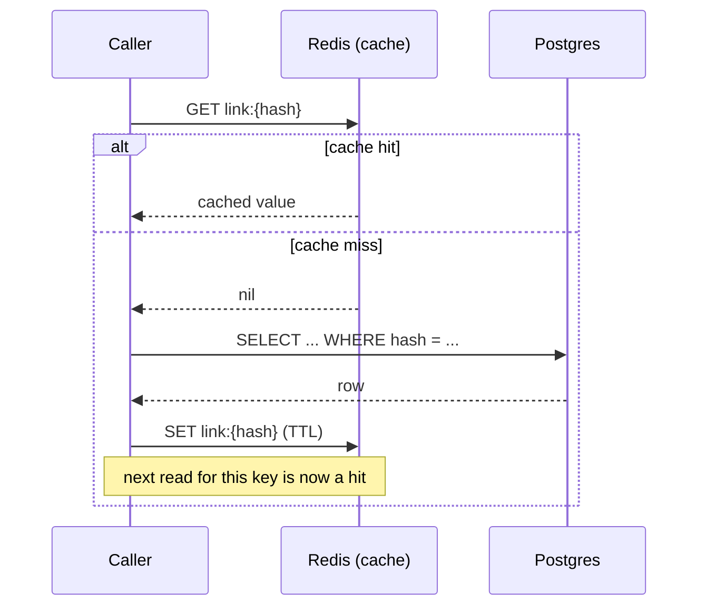

## What it is

Cache-aside (a.k.a. lazy-loading) caching: an application checks a fast in-memory store before
querying its actual database, and populates that store on a miss. See
[Redis's own intro](https://redis.io/docs/latest/develop/get-started/) for the general concept —
this doc covers the pattern, not any one product.

## What it solves

A relational database is a poor fit for read paths that are hit far more often than they change.
Scenario 1's redirect path (`GET /{hash}`) is the clearest example in this project: a link is
written once and then read every time someone clicks it — potentially thousands of times — so
routing every read through Postgres wastes capacity on work whose answer almost never changes.

## How it works

1. On a read, check the cache first (keyed by whatever identifies the entity — here, the link's
   hash).
2. **Hit:** return the cached value, skip the database entirely.
3. **Miss:** query the database, then write the result into the cache (usually with a TTL) before
   returning it, so the *next* read for the same key is a hit.
4. On a write that changes the underlying data, invalidate (or update) the corresponding cache
   entry — otherwise readers keep seeing the stale cached value until its TTL expires.



The trade-off this pattern always carries: the cache can now be wrong for a window (write landed
in the DB, cache invalidation hasn't happened or hasn't propagated yet) — see the Pitfalls below
for where that shows up concretely in this codebase, and step 4 above for the mechanism that's
supposed to keep the window short.

**A cache must never be a second source of truth.** Whatever backs it (Redis here) should be
treated as disposable — every entry is reconstructible from the database, so losing the whole
cache is a performance blip, never a correctness problem. This is also why cache failures should
degrade to "go to the database," never propagate as an error — see
[a real instance of this project getting that wrong before fixing it](pitfall:cache-read-no-error-handling).

## How it's implemented here

Generic across any cached entity via `EntityCacheService<T>` (`src/backend/Shared/Common/
EntityCacheService.cs`) — `GetOrFetch(id, fetchFromDb, ct)` is steps 1-3 above in one call.
[Redis](node:redis-master) is the concrete store; see that node's doc for the actual key format and the
two real bugs found in this exact code path.

### Two tiers: an in-process L1 ahead of Redis

Even a Redis hit still pays a real network round trip. `EntityCacheService<T>` checks a per-process
`IMemoryCache` ("L1") *before* Redis ("L2," the tier described above): an L1 hit returns with zero
network round trips, measured live dropping a repeated read from ~79ms (Redis) to ~1.9ms (L1). A
Redis hit populates L1 before returning, so the *next* read of that key is an L1 hit; a full miss
populates both tiers once the DB fetch returns.

L1's TTL is a fixed, short 2 seconds — deliberately much shorter than Redis's own per-entity TTL
(default 3600s), because L1 has no cross-process invalidation. `InvalidateCacheAsync` evicts the L1
entry on whichever process handled the invalidation, but a different replica's own L1 copy of the
same key is untouched and keeps serving the old value until its own 2-second TTL expires — see
[the cross-replica staleness pitfall](pitfall:l1-cache-cross-replica-staleness-window) for why that
window is an accepted tradeoff, not a bug to close. Gated independently via `Cache:L1Enabled`
(control-panel toggle: a per-node "L1 (in-process) cache" control on LinkApi's/RedirectApi's own
panels, not inside the Topology modal — L1 doesn't change which nodes are in the active request
graph, so it isn't staged there).

### Negative caching: memoizing a miss, not just a hit

A cache-aside read only shields the database from repeat *hits* — a caller scanning hashes that
don't exist (a bot probing random short codes, or sustained 404 traffic) sends every miss straight
through to Postgres, forever. `GetOrFetch` also checks a short-TTL (10s) "this id doesn't exist"
marker, stored under a separate key namespace (`neg:{key}`) in both L1 and Redis, checked *after*
the positive-cache checks and *before* the real DB fetch.

**No explicit eviction on write, by design.** The textbook fix — evict the negative marker on
every positive write — isn't needed here: positive and negative entries live under different keys
(no race for the same slot), and `GetOrFetch` always checks positive before negative, with no
exception. The instant a real entity is written anywhere, the very next read finds the positive key
first and never reaches the negative check again — a stale negative marker left behind just ages
out unread, not "cleaned up in time by a race that happened to resolve correctly." Gated
independently via `Cache:NegativeEnabled` (same per-node, immediate-apply control shape as L1's
toggle).

Both L1 and negative caching are only wired into `link-api`/`redirect-api`; `ShortenerService` also
uses `EntityCacheService<Link>` (to pre-warm the cache after persisting, plus the deletion
tombstone write) but always runs with `Cache:L1Enabled`/`Cache:NegativeEnabled` hardcoded `true`,
regardless of what either control-panel toggle shows — those sub-flags were never extended to it.
The main `Cache:Enabled` switch is different and does reach it (a gap where toggling caching off
left this node still warming/writing to Redis, found and fixed by an external review — see
[ShortenerService](node:shortener-service)); only the L1/negative sub-flags remain
link-api/redirect-api-only.

### TTL jitter: avoiding a synchronized expiry wave

`CacheAsync`'s default TTL is a flat 3600s, used by every write unless overridden — most
importantly `ShortenerService`'s `LinkCreatedConsumer`, which caches every newly-created link. A
burst of link creations (10k in one minute, a realistic launch-traffic or load-test scenario) would
all expire in the same one-second window an hour later — a correlated miss wave against Postgres, a
non-obvious failure mode if you don't already know to look for it.

```csharp
// src/backend/Shared/Common/EntityCacheService.cs
private const double TtlJitterFraction = 0.1;
private static double ApplyTtlJitter(int ttlSeconds) =>
    ttlSeconds * (1 + ((Random.Shared.NextDouble() * 2) - 1) * TtlJitterFraction);
```

This is **bounded** jitter (`Uniform(ttlSeconds * 0.9, ttlSeconds * 1.1)`), not full jitter — the
opposite shape from [the retry-polling jitter in Async messaging](pattern:async-messaging),
deliberately: full jitter on a TTL (`random(0, ttl)`) would roughly halve the *expected* cache
lifetime, hurting hit rate for no benefit. A retry delay cares more about decorrelation than
cadence predictability; a cache TTL cares more about predictable average lifetime. A ±10% spread
already turns a one-second-wide expiry spike into a window roughly 10% of the TTL wide (~12 minutes
on the default 3600s TTL) — enough to prevent a synchronized miss wave while keeping the *expected*
lifetime exactly equal to `ttlSeconds`.

This applies to every call to `CacheAsync`, including `LinksController`'s own 60s optimistic cache
write (see [LinkApi](node:link-api)) — that entry now resolves to 54-66s instead of exactly 60s,
harmless since it's normally overwritten by the durable 3600s write within seconds, well before
either TTL would matter.

### An alternative backend: `Microsoft.Extensions.Caching.Hybrid`

Everything above describes `EntityCacheService<T>`, a hand-rolled implementation that doubles as a
*teaching* piece: it spells out L1/L2 layering, single-flight coalescing, negative caching, and TTL
jitter explicitly, in code a reader can step through. A second, swappable implementation,
`HybridEntityCacheService<T>`/`HybridLinkCacheService` (`src/backend/Shared/Common/
HybridEntityCacheService.cs`), wraps the BCL's own `Microsoft.Extensions.Caching.Hybrid` package
instead — same contract, same Redis key format (`link:{id}`), selected per-service at startup via
`Cache:Backend` (`legacy` default, `hybrid` opt-in, mirroring the existing `Messaging:Mode`
toggle's fail-loudly-on-a-typo shape). `LinkApi`, `RedirectApi`, and `ShortenerService` each select
it independently.

The point isn't "hybrid is better" — it's the opposite: having both side by side, one env var apart,
lets a reader see exactly what ~280 lines of hand-rolled cache-aside logic buys over the BCL
primitive, and where the two diverge in observable behavior. `HybridCache.GetOrCreateAsync` gives
per-key single-flight coalescing for free (no `ConcurrentDictionary<string, Lazy<Task<T?>>>`
needed), but the scope is deliberately **not full parity**:

- No negative-cache TTL, no Polly circuit breaker, no `Cache:L1Enabled`/`Cache:NegativeEnabled`
  sub-toggles — `HybridEntityCacheService` is always "on" once selected, with no equivalent demo
  switches.
- **The null-caching TTL surprise.** HybridCache *does* cache a `null` `GetOrFetch` result — the
  factory isn't re-invoked on the next call for the same id, so it provides negative caching "for
  free." But it uses the exact same TTL as a positive entry (3600s, jittered), not
  `EntityCacheService`'s deliberately short, separate 10-second negative-cache window (see "Negative
  caching" above). A hash that doesn't exist yet but is about to be created stays "not found" for up
  to an hour under the hybrid backend, instead of 10 seconds under the legacy one — a real
  behavioral difference between the two backends, not a missing feature on either side.

`Cache:Backend=hybrid` has been unit-tested against a real in-process `HybridCache` (no mock) but
not yet exercised against the real Docker/Redis stack — a known, deliberate gap at the time of
writing, not an oversight.

## Pitfalls

- 🐛 [Redis outage used to 500 every link read](pitfall:cache-read-no-error-handling)
  (resilience-gap) — fixed
- 🐛 [No de-duplication for concurrent cache misses](pitfall:cache-concurrent-miss-no-dedup)
  (concurrency) — fixed
- 🐛 [Shared `Common` library pulled in the full Redis client just for one interface](pitfall:common-lib-full-redis-client-dependency)
  (coupling) — fixed
- ⚠️ [Two independent event consumers doubled load on a shared rate-limited external API](pitfall:geoip-dual-consumer-rate-limit-doubling)
  (architecture-bug) — fixed
- ⚠️ [Shared-cache DI wiring copy-pasted across two independently deployed services](pitfall:geoip-cache-wiring-duplicated-across-services)
  (coupling) — fixed
- ⚠️ [A side-effect cache failure took down an entire gRPC request, not just the caching optimization](pitfall:geoip-cache-write-failure-fails-grpc-request)
  (resilience-gap) — fixed
- ⚠️ [Fail-open that only caught RedisException let timeouts fail the redirect](pitfall:fail-open-catch-too-narrow)
  (resilience-gap) — fixed
- ⚠️ [A fail-open tombstone write is not enough on its own to invalidate an already-cached entity](pitfall:deletion-tombstone-alone-leaves-stale-cache-entry)
  (resilience-gap) — fixed
- ⚠️ [A second cache tier ahead of a shared cache reintroduces the staleness problem the shared one solved](pitfall:l1-cache-cross-replica-staleness-window)
  (race-condition) — known limitation
- 🐛 [A new cache tier can forget to honor the flag that's supposed to disable every tier](pitfall:negative-cache-tier-not-gated-on-overall-cache-toggle)
  (architecture-bug) — fixed
- ⚠️ [A second cache-backend implementation quietly dropped a jitter detail the first one got right](pitfall:hybrid-cache-backend-missing-ttl-jitter)
  (performance) — fixed

## Relatives

### Nodes

- [Redis](node:redis-master)
- [LinkApi](node:link-api)
- [RedirectApi](node:redirect-api)
- [TrafficService](node:traffic-service) — a second, independent cache (geo-IP lookups via
  `CachingGeoIpResolver`) using the same cache-aside idea, not `EntityCacheService`
- [ShortenerService](node:shortener-service) — invalidates the main `link:{hash}` cache-aside
  entry on delete/expiry (step 4's invalidate-on-write, from a different process than the one that
  originally wrote the entry)

### Patterns

- [Async messaging](pattern:async-messaging) — one of this pattern's own fan-out pitfalls was
  fixed by sharing a cache between two independent consumers
- [Circuit breakers](pattern:circuit-breakers) — a Polly breaker sits in front of every Redis call
  this pattern makes
