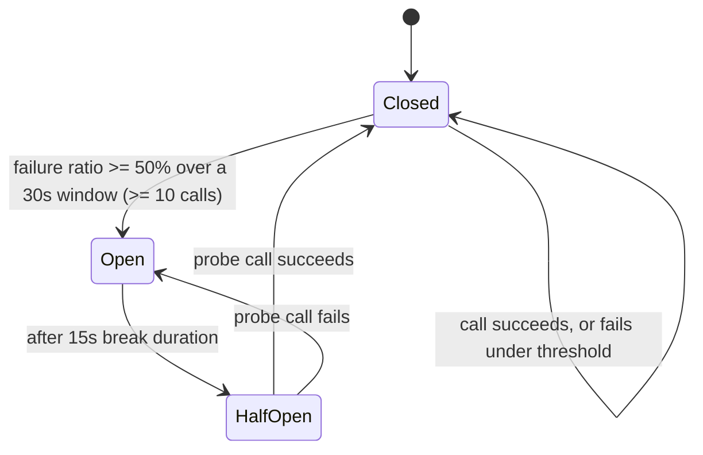
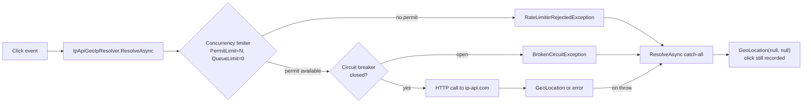

## What it is

A circuit breaker ([Polly](https://www.pollydocs.org/) v8's `ResiliencePipeline` here) wraps a call
to a dependency and tracks its recent failure rate. Once failures cross a threshold within a
sampling window, the breaker "opens": every call fails immediately with `BrokenCircuitException`
instead of attempting the real call, for a fixed break duration. After that, it goes "half-open"
and lets exactly one probe call through — success closes the breaker again, failure re-opens it.

## What it solves

Every dependency call in this project already degrades gracefully when it fails — a Redis miss
falls through to Postgres, a RabbitMQ publish failure spills into the SQLite fallback queue (see
[Caching](pattern:caching) and [Async messaging](pattern:async-messaging)). That's fail-*open*, not
fail-*fast*: a plain `try`/`catch` can only react once the failing call actually fails, which means
every single request still pays that dependency's full connect/timeout cost first. If a dependency
isn't just erroring occasionally but is genuinely dead (container stopped, network partition), that
cost is paid on *every* request, even though the eventual outcome never changes. A circuit breaker
short-circuits that: once it's learned a dependency is down, it rejects calls immediately instead of
letting each one time out on its own, and periodically re-tests on its own schedule so recovery is
detected without flooding the dependency with probes.

This is a pure latency/throughput optimization layered on top of existing fail-open behavior — it
does not change what happens on an isolated, non-systemic failure, and for most of this project's
call sites it doesn't even change the response shape, since the fail-open `try`/`catch` underneath
is unchanged.

## How it works

One shared builder, `BuildCircuitBreaker(dependencyName, logger)`
(`src/backend/Shared/Common/ResiliencePipelines.cs:20`), configures the same tuning for every call
site that uses it:

```csharp
// src/backend/Shared/Common/ResiliencePipelines.cs:20-69 (shape, trimmed)
new ResiliencePipelineBuilder()
    .AddCircuitBreaker(new CircuitBreakerStrategyOptions
    {
        FailureRatio = 0.5,
        MinimumThroughput = 10,
        SamplingDuration = TimeSpan.FromSeconds(30),
        BreakDuration = TimeSpan.FromSeconds(15),
        ShouldHandle = new PredicateBuilder().Handle<Exception>(ex => ex is not OperationCanceledException),
        OnOpened = /* log + increment resilience.circuit_breaker.transitions{dependency,state=opened} */,
        OnHalfOpened = /* ...state=half-opened */,
        OnClosed = /* ...state=closed */,
    })
    .Build();
```

- **Needs at least 10 calls in a rolling 30s window with ≥50% failing before it opens** — a handful
  of isolated failures never trips it; only a sustained failure rate does.
- **Stays open for 15s**, then lets one half-open probe through before deciding whether to close
  again.
- **`OperationCanceledException` never counts as a failure** — a client disconnect or an upstream
  deadline firing is not the dependency's fault, and counting it would let an unrelated flood of
  cancellations trip the breaker for every other caller too.
- **Every transition is logged and counted** (`resilience.circuit_breaker.transitions`, an OTel
  counter tagged by `dependency` and `state`). Without this, an open breaker "silently heals" the
  request path — everything just starts failing fast — with nothing anywhere signaling that a
  dependency is currently being bypassed.



In `Open`, every call fails immediately with `BrokenCircuitException` — the real dependency is
never touched until the breaker transitions to `HalfOpen` and lets one probe through.

**Keyed DI, one breaker instance per dependency per process.** Each wrapped dependency gets its own
`ResiliencePipeline` registered as a *keyed* singleton, keyed by a constant
(`Constants.RedisCircuitBreakerKey`/`GrpcCircuitBreakerKey`/`RabbitMqCircuitBreakerKey`) rather than
a plain singleton — a single process can host more than one of these (a service that both caches in
Redis and dispatches over gRPC needs two independent breakers, not one type-keyed registration
fighting over which dependency it represents). Registration sits next to each dependency's own
extension method, so the breaker's lifetime matches the dependency's.

## How it's implemented here

Four call sites wrap the shared builder's output around a single dependency call, inside the
`try`/`catch` that already existed:

1. **`EntityCacheService<T>`/`LinkCacheService`** (Redis breaker) — `CacheAsync`/
   `InvalidateCacheAsync`/`GetCachedAsync` each wrap their single Redis call in
   `_resilience.ExecuteAsync(...)`. `BrokenCircuitException` is just another `Exception` to the
   existing catch block, so it falls straight into "treat as a cache miss / continue without
   caching" — see [Caching](pattern:caching).
2. **`CachingGeoIpResolver`** — reuses the *same* Redis breaker instance (there is one Redis breaker
   per process, not one per consumer of Redis).
3. **`SyncGrpcDispatcher`** (gRPC breaker) — the messaging-mode toggle's synchronous transport
   (`Messaging:Mode=grpc`). This is the one call site with **no** fail-open fallback by design: a
   `BrokenCircuitException` (or the underlying `RpcException`) propagates out to the controller and
   from there to `GlobalExceptionHandler`, which maps it to a `503 Service Unavailable`
   `ProblemDetails` response. It's the only one of the four breakers whose state is ever visible
   outside logs/metrics, for the same reason the sync-gRPC mode exists at all — see
   [Async messaging](pattern:async-messaging).
4. **`RabbitMqPublisher`** (RabbitMQ breaker) — wraps only `RentChannelAsync` (opening/reusing a
   pooled AMQP channel), deliberately **not** the subsequent `BasicPublishAsync` call, so the
   existing channel-release bookkeeping in `finally` keeps working unchanged regardless of which
   call failed. A rejected rent (via the breaker or otherwise) falls through to the pre-existing
   SQLite fallback save — the breaker makes reaching that fallback cheaper, it doesn't replace it.

**A fifth dependency, ip-api.com's `HttpClient`, uses a different mechanism entirely**: `HttpClient`
already has its own idiomatic resilience hook
(`Microsoft.Extensions.Http.Resilience`'s `AddResilienceHandler`), so `GeoIpExtensions` attaches a
breaker directly to the typed client instead of going through `ResiliencePipelines.BuildCircuitBreaker`
— same tuning values, hand-copied rather than shared, plus an extra rule treating any HTTP 5xx
response as a failure.

```csharp
// src/backend/Shared/Common/Constants.cs:47-52
public const string RedisCircuitBreakerKey = "redis";
public const string GrpcCircuitBreakerKey = "grpc";
public const string RabbitMqCircuitBreakerKey = "rabbitmq";
```

## A related pattern: bulkhead isolation

A circuit breaker only reacts to a **failure ratio** — it does nothing if a dependency is merely
*slow* rather than down. TrafficService and ReportingService's ip-api.com geo-IP lookups (the fifth
dependency above, point 5) sit behind a second, independent Polly v8 strategy that covers exactly
that gap: a concurrency limiter (`AddRateLimiter`) capping how many `ip-api.com` calls either
service can have in flight at once, rejecting anything over the limit immediately instead of
letting it queue. It's named "bulkhead" after the shipbuilding term — sealing off one slow
compartment so it can't flood and starve everything else sharing the same process (HttpClient
connections, thread-pool work).

```csharp
// src/backend/Shared/Infrastructure/GeoIpExtensions.cs:49-93 (shape, trimmed)
.AddResilienceHandler("geo-ip-circuit-breaker", (resilience, context) =>
{
    resilience
        .AddRateLimiter(new RateLimiterStrategyOptions
        {
            DefaultRateLimiterOptions = new ConcurrencyLimiterOptions
            {
                PermitLimit = maxConcurrentRequests,   // GeoIp:MaxConcurrentRequests, default 10
                QueueLimit = 0,                         // reject immediately, never queue
            },
            OnRejected = args =>
            {
                logger.LogWarning("Geo-IP concurrency limit ({Limit} in flight) rejected a call...");
                ResilienceMetrics.BulkheadRejections.Add(1, new("dependency", "geo-ip"));
                return default;
            },
        })
        .AddCircuitBreaker(new() { /* unchanged: FailureRatio=0.5, MinimumThroughput=10, ... */ });
});
```



- **Ordering is deliberate: the rate limiter is added *before* the circuit breaker in the same
  pipeline.** A call rejected by the concurrency limiter never reaches the breaker, so a burst of
  concurrency rejections never counts against the breaker's own `FailureRatio` — the two strategies
  protect against two independent failure modes (slow vs. down) and shouldn't contaminate each
  other's statistics. Reversing the order would let pure concurrency pressure trip the breaker open,
  with nothing enforcing the correct order beyond the sequence of two method calls.
- **`AddRateLimiter(RateLimiterStrategyOptions)`, not the simpler `AddConcurrencyLimiter` overload** —
  the simple overload only accepts the BCL's own `ConcurrencyLimiterOptions`, which has no rejection
  callback; the lower-level overload adds `OnRejected` for logging/metrics while keeping identical
  limiting behavior.
- **`QueueLimit = 0`** — reject immediately rather than queue excess calls, mirroring
  [RedirectApi](node:redirect-api)'s own request-budget load-shedding choice
  (`Redirect:RequestBudgetMs`): abandoning a call that can't start right now beats queuing it, since
  queuing risks this consumer's own RabbitMQ batch timeout.
- **No call-site change needed** — `Polly.RateLimiting.AddRateLimiter` throws
  `RateLimiterRejectedException` on rejection, just another `Exception` to `IpApiGeoIpResolver.
  ResolveAsync`'s existing catch-all, which already turns *any* failure (private IP, timeout, HTTP
  error, now also a rejection) into `GeoLocation(null, null)` rather than throw — a rejection and a
  genuinely dead dependency look identical downstream; only the OTel counters tell them apart
  (`resilience.bulkhead.rejections` vs. `resilience.circuit_breaker.transitions{state=opened}`).
- **Deliberately manual, not self-tuning** — `GeoIp:MaxConcurrentRequests` (default 10) is read once
  at startup and changed only by recreating both containers (via the `geoip-bulkhead` control-api
  capability or the `GEOIP_BULKHEAD_LIMIT` env var), not auto-adjusted from observed latency/rejection
  rate — a dial a human turns and observes, matching this project's visible-cause-and-effect teaching
  model over hidden automation.
- **Private/loopback/docker-internal IPs never reach the limiter** — `ResolveAsync` short-circuits to
  "no geo data" before the `HttpClient` (and the whole resilience pipeline) is even touched for any
  non-public IP, which matters when trying to reproduce rejections in a local docker-compose run
  where most client IPs are docker-internal.

## Pitfalls

No pitfall-docs recorded for this pattern yet — the tuning duplication between the shared builder
and ip-api.com's hand-copied `HttpClient` values (see "How it works") is a real drift risk worth
watching, but nothing has actually drifted yet, so there's no before/after to show. The same applies
to the rate-limiter-before-breaker ordering rule above: nothing enforces it beyond code review.

## Relatives

### Nodes

- [Redis](node:redis-master) — the shared breaker behind `EntityCacheService`/`CachingGeoIpResolver`
- [RabbitMQ](node:rabbitmq) — the breaker in front of `RentChannelAsync`
- [LinkApi](node:link-api) — Redis breaker (cache reads/writes), RabbitMQ breaker (publish)
- [RedirectApi](node:redirect-api) — Redis breaker (cache reads/writes), RabbitMQ breaker (publish)
- [ShortenerService](node:shortener-service) — gRPC breaker when `Messaging:Mode=grpc`
- [TrafficService](node:traffic-service) — gRPC breaker when `Messaging:Mode=grpc`; Redis breaker
  via `CachingGeoIpResolver`; geo-IP bulkhead (concurrency limiter) in front of the same ip-api.com
  calls
- [ReportingService](node:reporting-service) — Redis breaker via `CachingGeoIpResolver`; geo-IP
  bulkhead (concurrency limiter) in front of the same ip-api.com calls

### Patterns

- [Caching](pattern:caching) — the Redis breaker sits in front of this pattern's cache-aside calls
- [Async messaging](pattern:async-messaging) — the RabbitMQ and gRPC breakers both sit on this
  pattern's transports
