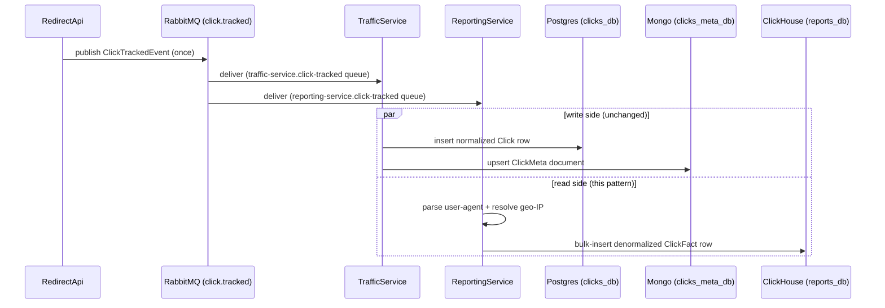

## What it is

Command Query Responsibility Segregation, built here the cheapest way that still teaches the real
lesson: instead of a separate write model/command bus, the **write side stays exactly what it
already was** ([TrafficService](node:traffic-service) consuming `ClickTrackedEvent` into Postgres/
Mongo), and the **read side gets its own independent consumer**
([ReportingService](node:reporting-service)) of the *same* event, building its own denormalized
read model in a store picked for querying, not for writing — [ClickHouse](node:clickhouse).

## What it solves

The per-link stats panel ([ReportingApi](node:reporting-api) serves it) wants aggregate, filterable
queries — clicks by day, by country, by device, by browser — over a dataset that only grows. Running
those queries against `clicks_db` (Postgres, [TrafficService](node:traffic-service)'s audit-trail
store) would mean every stats request competing with real click-tracking write traffic for the same
table, and Postgres row-store scans aren't what a `GROUP BY day, country` over millions of rows wants
in the first place. Splitting the query workload onto a store built for exactly that — and a
consumer that writes to it independently — means neither side has to compromise for the other.

## How it works

1. [RedirectApi](node:redirect-api) publishes `ClickTrackedEvent` once, same as always — it has no
   idea a second consumer exists. See [Async messaging](pattern:async-messaging) for the publish
   side; this pattern is entirely about what happens after.
2. **Two independent consumers bind their own queue to the same routing key** — this is fan-out, not
   a chain. [TrafficService](node:traffic-service)'s queue and
   [ReportingService](node:reporting-service)'s queue each get their own copy of every message;
   RabbitMQ delivers to both, and neither waits on or knows about the other.
3. Each consumer builds the representation *it* needs from the same raw event: TrafficService writes
   the normalized audit-trail row (and a separate enrichment document — see that node's own "why two
   stores" reasoning, a smaller-scale version of the same idea). ReportingService writes one wide,
   denormalized `ClickFact` row per click, with parsed user-agent and geo-IP already resolved at
   write time, so a read never has to re-derive them.
4. The two models can and do drift from each other in shape — Postgres's `Clicks` table has a real
   foreign-key-adjacent structure; ClickHouse's `clicks` table is one flat table ordered for the
   query patterns ReportingApi actually runs (`ReplacingMergeTree ORDER BY (hash, id)`, see
   [Data retention](pattern:data-retention-partitioning) for what that ordering also buys for TTL
   enforcement). That's the point of CQRS, not an inconsistency to fix.



Both consumers bind their own queue to the same `click.tracked` routing key — RabbitMQ fans the
same message out to each, neither consumer waits on or is aware of the other.

**What this isn't.** A textbook CQRS setup usually also means a command bus, a distinct write model
object graph, and often eventual-consistency tooling (an event store, a projection framework). None
of that exists here — "the read side" is one extra consumer and one extra table. The segregation
that matters for the lesson (independent read/write models, independently scalable, independently
query-shaped) is present; the ceremony around it isn't, deliberately, since this project's own event
sourcing already comes for free from RabbitMQ's fan-out rather than needing to be built.

## How it's implemented here

```csharp
// src/backend/Services/ReportingService/ClickTrackedConsumer.cs:20
private const string QueueName = "reporting-service.click-tracked";
// ...
protected override Task ExecuteAsync(CancellationToken stoppingToken) =>
    _consumer.ConsumeBatchAsync<ClickTrackedEvent>(QueueName, Topics.ClickTracked, HandleBatchAsync, stoppingToken);
```

A new queue name bound to the *existing* `click.tracked` routing key is the entire fan-out
mechanism — nothing on the publish side changed when this consumer was added. `ClickFact` rows are
inserted in one bulk call per batch, never per-row (`InsertManyAsync`) — a real ClickHouse
anti-pattern this service specifically avoids, since ClickHouse is built around bulk ingestion, not
many small transactions.

## Pitfalls

- 🐛 [Two independent event consumers doubled load on a shared rate-limited external API](pitfall:geoip-dual-consumer-rate-limit-doubling)
  (architecture-bug) — fixed
- 🐛 [Shared-cache DI wiring copy-pasted across two independently deployed services](pitfall:geoip-cache-wiring-duplicated-across-services)
  (coupling) — fixed
- 🐛 [A ClickHouse client registered as a singleton still opened a fresh HttpClient on every call](pitfall:clickhouse-unpooled-httpclient-per-call)
  (connection-pooling) — fixed
- 🐛 [ClickHouse's healthcheck could pass before its init script finished creating the table](pitfall:clickhouse-healthcheck-passes-before-init-script-completes)
  (infrastructure-bug) — fixed
- 🐛 [A reporting query ran five independent round trips sequentially, one of them redundant](pitfall:clickhouse-summary-query-sequential-and-redundant)
  (db-query) — fixed

## Relatives

### Nodes

- [ReportingService](node:reporting-service) — the fan-out consumer, the CQRS write side for reports
- [ReportingApi](node:reporting-api) — the CQRS read side
- [TrafficService](node:traffic-service) — the other, independent consumer of the same event
- [ClickHouse](node:clickhouse)

### Patterns

- [Async messaging](pattern:async-messaging) — the fan-out mechanism this pattern builds on
- [Data retention](pattern:data-retention-partitioning) — ClickHouse's own `TTL` clause on the same
  table this pattern writes to
