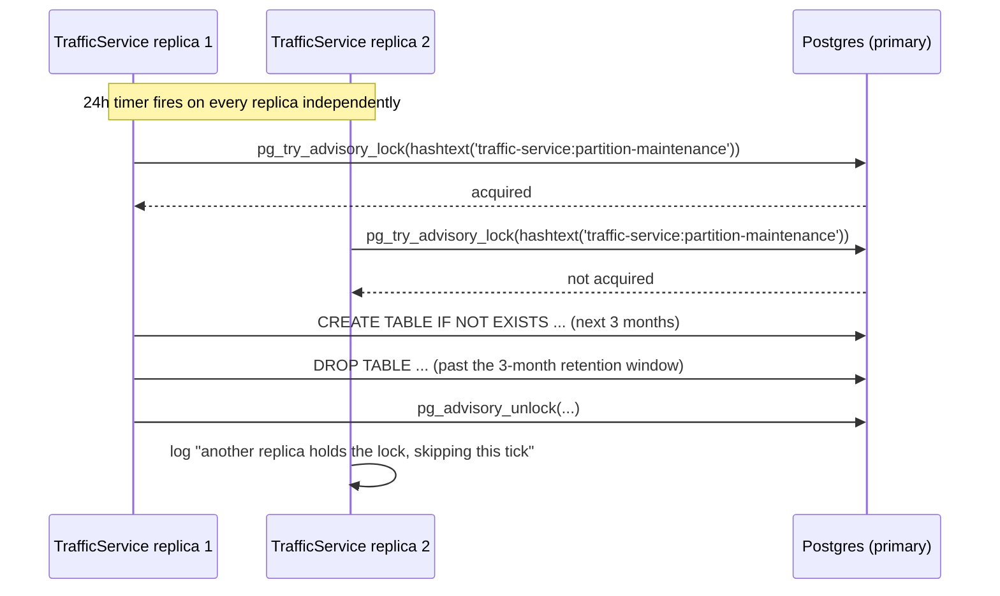

## What it is

Keeping click data from growing forever, demonstrated three different ways on purpose, one per
store: Postgres native declarative partitioning, a Mongo TTL index, and a ClickHouse `TTL` clause.
Same underlying goal — bound how much history each store holds — three genuinely different
mechanisms, because each store's own architecture makes a different one the right one.

## What it solves

[TrafficService](node:traffic-service) and [ReportingService](node:reporting-service) both write a
row per click, forever, by construction — nothing in this project's normal operation ever deletes a
click on its own. Left alone, `clicks_db` (Postgres), `clicks_meta_db` (Mongo) and `reports_db`
(ClickHouse) all grow unbounded. Unbounded growth is a real production failure mode (storage cost,
and — for Postgres specifically — ever-slower full-table scans for anything that doesn't have a
useful index), not a hypothetical one, so each store needs an actual retention story.

## How it works

**Postgres (`clicks_db.clicks`) — native declarative partitioning**, monthly
(`PARTITION BY RANGE ("ClickedAt")`). Retention here means dropping a whole partition
(`DROP TABLE`) instead of a `DELETE ... WHERE` that has to find and remove matching rows one at a
time — at scale, a `DROP` is near-instant regardless of how many rows were in that partition, while
a row-at-a-time `DELETE` gets slower as the matching set grows and leaves dead tuples behind for
`VACUUM` to clean up. Partitioning also narrows which partition(s) a time-bounded query even has to
look at (see "Partition pruning" below) — a retention mechanism and a query-performance mechanism,
from the same feature.

**Mongo (`clicks_meta_db.clicks`) — a TTL index** on `ClickedAt`. Mongo's own background TTL monitor
(runs roughly once a minute) deletes expired documents on its own — no partitions, no maintenance
job to build. The tradeoff: Mongo decides when, not the application, and there's no equivalent to
partition pruning — a query without a useful index still has to consider every document regardless
of age.

**ClickHouse (`reports_db.clicks`) — a `TTL` clause** on the table itself
(`clicked_at + INTERVAL 90 DAY DELETE`), enforced lazily during ClickHouse's own background merges —
the same mechanism that already collapses `ReplacingMergeTree` duplicates on this table (see
[CQRS fan-out](pattern:cqrs-fanout)) now also drops expired rows during the same pass. No separate
job, but also no precise deadline — a row can outlive its TTL by however long it takes for a merge
to touch its part.

Mongo and ClickHouse share the same **90-day** retention window on purpose (`MongoClickMetaStore
.RetentionWindow`, `clicked_at + INTERVAL 90 DAY DELETE`) — one number told as the same story in two
different stores, not two unrelated numbers that happen to be close. Postgres's retention window is
expressed differently — in whole months, not days — since Postgres can only drop whole partitions;
see "The maintenance job" below for the exact conversion.

### Converting an existing table to partitioned

Postgres has no `ALTER TABLE ... PARTITION BY` — a table cannot be partitioned in place. The
technique used in `TrafficService.Migrations.ConvertClicksToPartitionedTable`:

1. Rename the old table *and its primary-key constraint* — renaming a table does **not** rename its
   constraints/indexes, so the old constraint's name has to be freed explicitly or the new table's
   identically-named one collides with it.
2. Create a new table, `PARTITION BY RANGE ("ClickedAt")`, with the composite primary key Postgres
   requires on a partitioned table (`("Id", "ClickedAt")` — the partition key must be part of every
   unique/primary key).
3. Create the initial partitions, computed at migration-*run*-time (`now()` inside a `DO $$ ... $$`
   block — 2 months back through 3 ahead of whenever the migration actually executes, not hardcoded
   literal dates that would drift stale between being written and being run), plus one `DEFAULT`
   partition that catches anything outside that window.
4. Copy every row from the old table into the new one, directly into each bootstrapped partition by
   date range — not through the partitioned parent table, which would force per-row tuple routing
   instead of a bulk per-partition copy.
5. Drop the old table.

Verified against the live stack's real `clicks_db` with 3,470,328 pre-existing rows, not an empty
database — row count identical afterward, every row landed in the correct monthly partition, zero
rows fell into `clicks_default`.

### Partition pruning

```bash
docker exec -it $(docker compose ps -q postgres) psql -U postgres -d clicks_db -c "
EXPLAIN SELECT count(*) FROM clicks WHERE \"ClickedAt\" >= '2026-10-01' AND \"ClickedAt\" < '2026-11-01';
"
```

The query plan touches only the one partition the date range actually falls in — every other
partition is skipped entirely, not even considered. A query without a `WHERE` on `ClickedAt` (or one
spanning several months) scans every partition it needs to, same as an unpartitioned table would
have for the whole thing.

### The maintenance job

Nothing about partitioning itself keeps the rolling window moving — new partitions have to be
created ahead of time, and old ones have to actually be dropped, or the bootstrap window above is
all you ever get. `PartitionMaintenanceWorker` (a `BackgroundService` in TrafficService) runs once
on startup and then every 24 hours:

- **Creates** partitions for the current month through 3 months ahead (matching the bootstrap
  migration's own window) — `CREATE TABLE IF NOT EXISTS ... PARTITION OF clicks FOR VALUES FROM (...) TO (...)`.
- **Drops** any dated partition fully past a 3-month retention window (quantized to whole months,
  since Postgres can only drop whole partitions — the same ~90-day horizon Mongo/ClickHouse use,
  just expressed in months instead of days). `clicks_default` is never a drop candidate, and a
  partition whose name doesn't match the expected `clicks_yYYYYmMM` shape is left alone rather than
  guessed at — a differently-named partition someone created by hand shouldn't get silently dropped.

`TrafficService` can run as several replicas (see [Async messaging](pattern:async-messaging) for
why it's scalable at all), and every replica runs this same 24-hour timer independently — without
coordination, N replicas would all try the same `CREATE`/`DROP` at once on the same tick. The DDL
itself is idempotent (`IF NOT EXISTS`/`IF EXISTS`), so a race wouldn't corrupt anything, just spam
duplicate log lines and duplicate DDL attempts. A Postgres **advisory lock**
(`pg_try_advisory_lock(hashtext('traffic-service:partition-maintenance'))`) makes "one replica does
the work, the rest skip this tick" the normal case — see
[Distributed locking: Postgres advisory locks](pattern:distributed-locking-postgres-advisory) for
the general mechanism (session-scoped release, the pgcat-bypass reasoning, the EF Core connection-
pinning requirement); this section covers only how it's wired into this specific maintenance job:

```csharp
// src/backend/Services/TrafficService/PartitionMaintenanceWorker.cs:84
await context.Database.OpenConnectionAsync(cancellationToken);
try
{
    if (!await TryAcquireAdvisoryLockAsync(context, cancellationToken))
    {
        _logger.LogDebug("Partition maintenance: another replica holds the lock, skipping this tick");
        return;
    }
    try { /* create/drop partitions */ }
    finally { await ReleaseAdvisoryLockAsync(context, cancellationToken); }
}
finally { await context.Database.CloseConnectionAsync(); }
```



The explicit `OpenConnectionAsync`/`CloseConnectionAsync` pinning one physical connection for the
whole critical section matters here specifically — see this pattern's Pitfalls for what happens
without it. All create/drop DDL bypasses PgCat entirely, connecting straight to the primary (same
reasoning as the bootstrap migration — DDL through a query-classifying pooler is inherently
fragile, see [Read-replica routing](pattern:read-replica-routing)'s own Pitfalls).

The partition-naming logic (which months to create, which to drop) lives in a separate, pure
`PartitionPlanner` class with no I/O — native partitioning has no InMemory/SQLite equivalent to
test against, so keeping the decision logic separate from the DDL execution is what makes any of
this unit-testable at all.

## Known, accepted limitations

- **`Click`'s composite primary key no longer enforces `Id` as globally unique on its own** — only
  the full `(Id, ClickedAt)` pair, since Postgres can't express a true cross-partition unique
  constraint on a non-partition-key column. `clicks_meta_db.ClickMeta` (Mongo) upserts by `Id`
  alone, so a hypothetical row pair sharing an `Id` with different `ClickedAt` values would desync
  the two stores. Nothing in this codebase currently produces that pairing (`Id` and `ClickedAt` are
  generated once together and travel unchanged through every redelivery) — a structural limitation
  to stay aware of, not an active bug.
- **No frontend panel.** A partition-count/oldest-retained-data view was considered and decided
  against — the operational reality is directly inspectable via `psql`/`EXPLAIN` (above), and a live
  panel wasn't judged worth the added UI surface for what this pattern is teaching.
- **Attaching a partition back onto a populated `DEFAULT`** (if the maintenance job were ever
  disabled long enough for `clicks_default` to accumulate real data) requires Postgres to scan the
  entire `DEFAULT` partition under a heavy lock first, to prove no row in it violates the new
  partition's bounds, before the attach can succeed — at the 3.47M-row scale this project tested,
  that's a real, possibly multi-minute outage window on the live table. The maintenance job's own
  3-months-ahead lookahead exists specifically so this situation shouldn't arise in normal
  operation.

## Pitfalls

- 🐛 [`PartitionMaintenanceWorker`'s advisory lock could unlock the wrong Postgres session](pitfall:partition-maintenance-advisory-lock-session-mismatch)
  (connection-pooling) — fixed

## Relatives

### Nodes

- [TrafficService](node:traffic-service) — owns `clicks_db` and runs the maintenance job
- [ReportingService](node:reporting-service) — ClickHouse's own TTL, same underlying goal

### Patterns

- [CQRS fan-out](pattern:cqrs-fanout) — the ClickHouse table this pattern's TTL clause applies to
- [Read-replica routing](pattern:read-replica-routing) — why this pattern's DDL bypasses PgCat
- [Distributed locking: Postgres advisory locks](pattern:distributed-locking-postgres-advisory) —
  the general mechanism behind the maintenance job's cross-replica coordination
