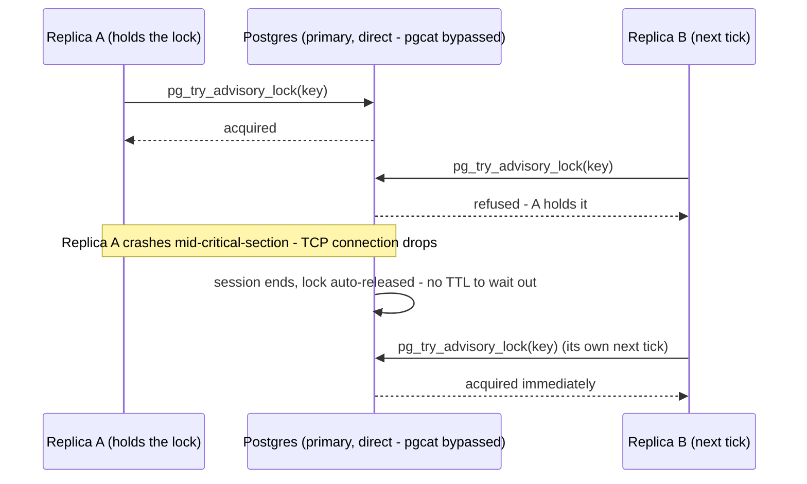

## What it is

Postgres's own built-in primitive for application-level mutual exclusion:
[advisory locks](https://www.postgresql.org/docs/current/explicit-locking.html#ADVISORY-LOCKS) —
`pg_try_advisory_lock(key)` (non-blocking: returns immediately, `true`/`false`) and
`pg_advisory_unlock(key)`, each keyed by a 64-bit integer that means whatever the application
decides. "Advisory" because Postgres enforces nothing about what the key refers to — it never
checks the key against any table or row, only that two sessions can't hold the same key at the
same time. A sibling function, `pg_advisory_xact_lock`, auto-releases at transaction end instead of
session end — not used here, since this project's critical section spans more than one statement
and needs the lock held across all of them, not just one transaction.

## What it solves

See [Distributed locking](pattern:distributed-locking) for the general problem. This
implementation's specific selling point: **the lock's lifetime is tied to a live network
connection, not a clock**. There's no TTL to guess, and no window where a crashed holder still
"owns" the lock on paper — the moment the physical connection drops, Postgres notices and releases
it, whether that's a clean unlock call, a crash, or a network partition.

## How it works

`hashtext()` turns a stable string name into the bigint key `pg_try_advisory_lock` actually wants
— the standard way to get a human-readable lock name without the application inventing its own
integer namespace:

```sql
SELECT pg_try_advisory_lock(hashtext('traffic-service:partition-maintenance')) AS "Value"
```

The session-scoping that makes crash-recovery automatic is exactly what makes this fragile in two
ways that don't exist for a plain SQL query:

- **A transaction-mode connection pooler breaks it outright.** [pgcat](node:pgcat) here runs in
  `pool_mode = "transaction"` (`sandbox/infra/pgcat/pgcat.toml.example`) — it only guarantees your
  statements land on *some* backend connection, not the same one across calls. Acquire and release
  can silently land on two different physical sessions, so this
  implementation bypasses pgcat entirely and connects straight to the primary (same reasoning as
  this project's DDL migrations — see [Read-replica routing](pattern:read-replica-routing)'s own
  Pitfalls for the general "DDL through a query-classifying pooler is inherently fragile" rule).
- **An ORM that implicitly opens/closes a connection per command breaks it too**, for the same
  underlying reason one level up the stack: EF Core's default "closed" just returns the connector
  to Npgsql's own client-side pool, with no guarantee the next open gets that same connector back.



## How it's implemented here

`PartitionMaintenanceWorker.RunOnceAsync`
(`src/backend/Services/TrafficService/PartitionMaintenanceWorker.cs:63-157`)
pins one physical connection open for the whole acquire → work → release section with an explicit
`OpenConnectionAsync`/`CloseConnectionAsync` pair — the EF Core-documented fix for exactly the
per-command-connection problem above:

```csharp
// src/backend/Services/TrafficService/PartitionMaintenanceWorker.cs:68-84 (trimmed)
var connectionString = _configuration.GetConnectionString(Constants.PostgresPrimaryConnectionString)
    ?? _configuration.GetConnectionString(Constants.PostgresConnectionString);
var options = new DbContextOptionsBuilder<DatabaseContext>().UseNpgsql(connectionString).Options;
await using var context = new DatabaseContext(options);

await context.Database.OpenConnectionAsync(cancellationToken);
try
{
    if (!await TryAcquireAdvisoryLockAsync(context, cancellationToken))
    {
        _logger.LogDebug("Partition maintenance: another replica holds the lock, skipping this tick");
        return;
    }
    try { /* create/drop partitions - see Data retention for the actual DDL */ }
    finally { await ReleaseAdvisoryLockAsync(context, cancellationToken); }
}
finally { await context.Database.CloseConnectionAsync(); }
```

```csharp
// src/backend/Services/TrafficService/PartitionMaintenanceWorker.cs:165-169
private static Task<bool> TryAcquireAdvisoryLockAsync(DatabaseContext context, CancellationToken cancellationToken) =>
    context.Database.SqlQueryRaw<bool>($"SELECT pg_try_advisory_lock(hashtext('{AdvisoryLockName}')) AS \"Value\"").SingleAsync(cancellationToken);

private static Task<int> ReleaseAdvisoryLockAsync(DatabaseContext context, CancellationToken cancellationToken) =>
    context.Database.ExecuteSqlRawAsync($"SELECT pg_advisory_unlock(hashtext('{AdvisoryLockName}'))", cancellationToken);
```

One EF Core-specific nuance worth knowing if you ever copy this: `SqlQueryRaw<T>` requires the
result set to have exactly one column, named `Value` — undocumented in the method signature,
only in EF's own result-mapping convention. `pg_try_advisory_lock`'s own result column is named
after the function, not `Value`, so the explicit `AS "Value"` alias isn't decoration — without it,
EF throws `column s.Value does not exist` at the wrapper-query level the moment the query actually
runs; `docker compose up` or a plain syntax check wouldn't catch it.

No library dependency — everything here is one raw SQL call plus EF Core's own connection API, no
Polly, no distributed-lock package.

## Pitfalls

- ⚠️ [A session-scoped advisory lock could be released on the wrong connection](pitfall:partition-maintenance-advisory-lock-session-mismatch) (connection-pooling) — fixed

## Relatives

### Nodes

- [TrafficService](node:traffic-service) — runs `PartitionMaintenanceWorker`
- [pgcat](node:pgcat) — the pooler this implementation deliberately bypasses

### Patterns

- [Distributed locking](pattern:distributed-locking) — the general problem and the comparison with the Redis implementation
- [Data retention](pattern:data-retention-partitioning) — the actual feature this lock coordinates replicas for
- [Read-replica routing](pattern:read-replica-routing) — why DDL bypasses pgcat in general, not just for this lock
