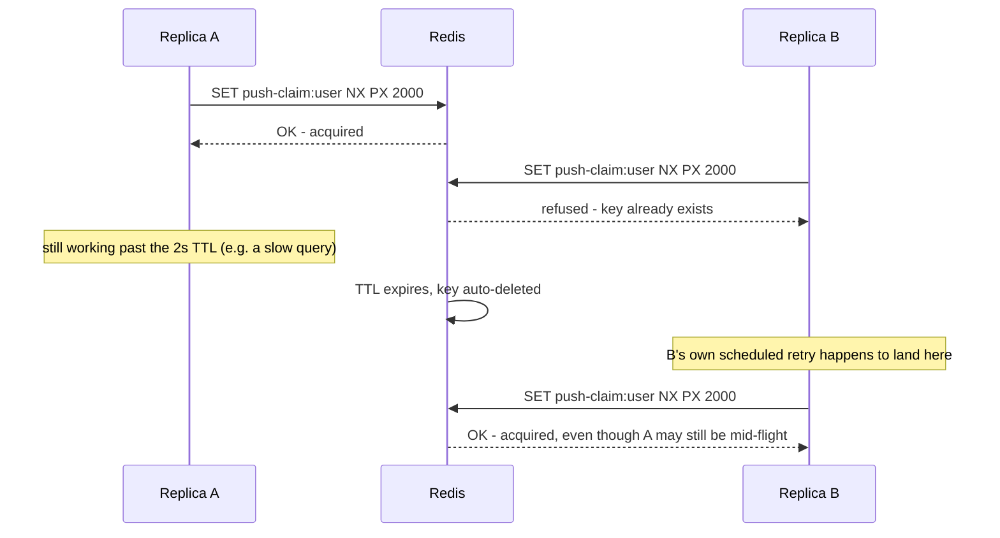

## What it is

Redis's atomic conditional-set: `SET key value NX PX ttl` — set the key only if it doesn't already
exist (`NX`), with an expiry in milliseconds (`PX`). Redis executes commands single-threaded, so
the "check it doesn't exist, then set it" happens as one indivisible server-side step — there's no
race window between two replicas' check and set the way there would be with a naive `GET` then
`SET`. StackExchange.Redis exposes this as `IDatabase.StringSetAsync(key, value, ttl,
When.NotExists)`.

**Honestly, this is not "Redlock."** Redis's own documented algorithm for a genuinely
safety-critical distributed lock runs against an odd number of *independent* Redis instances and
requires acquiring a majority of them within a tight clock budget. This project runs one Redis
primary — a single point of failure for the lock exactly as much as it already is for caching (see
[High availability & failover](pattern:high-availability-failover) for the Sentinel setup that
exists for the *data*, not for lock semantics specifically). That's an accepted trade-off here
because what this lock protects — see "What it solves" — is a bounded, low-stakes deduplication,
not something where a double-execution would be a real correctness bug.

## What it solves

See [Distributed locking](pattern:distributed-locking) for the general problem. This
implementation's specific shape: a **short-lived, TTL-scoped claim** that needs no dedicated
connection and works fine through any pooled Redis client — the trade-off for not needing a
pinned connection is that the lock's lifetime is a number you have to pick up front, not something
tied to a connection's own liveness (contrast with
[the Postgres advisory-lock implementation](pattern:distributed-locking-postgres-advisory)).

## How it works



That last step is the TTL implementation's known, accepted risk: if the holder's work legitimately
outlives the TTL, a second replica can acquire the same claim while the first is technically still
working — unlike the session-scoped Postgres lock, there's no live connection whose death the
coordinator can observe, only a clock. The TTL here is deliberately set to the same number the
caller would have throttled itself to locally anyway (see below), so an early release means "a
little more freshness than strictly necessary," not "two replicas doing conflicting writes."

**The failure-mode choice that matters more than the mechanism**: what happens when the *claim
call itself* fails (Redis unreachable)? This project answers that per call site based on the
stakes, not as a library default:

```csharp
// src/backend/Services/ReportingApi/Realtime/TopLinksPushService.cs:147-159
private async Task<bool> TryClaimPushAsync(Guid userId, CancellationToken cancellationToken)
{
    try
    {
        var db = _connectionMultiplexer.GetDatabase();
        return await db.StringSetAsync(PushClaimKey(userId), "1", MinPushInterval, When.NotExists);
    }
    catch (Exception ex) when (ex is not OperationCanceledException)
    {
        _logger.LogWarning(ex, "Failed to claim push for user {UserId} - proceeding without cluster-wide dedup for this tick", userId);
        return true; // fail OPEN
    }
}
```

Failing **open** here (treat a Redis error as "claim granted") means a Redis outage degrades back
to every replica pushing independently — this service's own pre-backplane behavior, and "a
dashboard might see one duplicate update" is strictly better than "no replica pushes anything at
all." A different call site with higher stakes makes the opposite call with the exact same
primitive: `AuthApi`'s Redis-backed rate limiter
(`src/backend/Shared/WebDefaults/RateLimitPolicy.cs:14-15`)
fails **closed** instead — an open window during a Redis outage on register/login would mean
unlimited brute-force attempts, so there "never block the hot path on a dependency outage" is the
wrong default. Same atomic claim, opposite failure-mode decision, chosen per call site by what a
false "proceed" would actually cost.

## How it's implemented here

`TopLinksPushService.PushAsync`
(`src/backend/Services/ReportingApi/Realtime/TopLinksPushService.cs:96-140`)
takes the cluster-wide claim before doing any real work — querying ClickHouse or sending to the
SignalR group — so a replica that loses the race does neither:

```csharp
// src/backend/Services/ReportingApi/Realtime/TopLinksPushService.cs:108-111
if (!await TryClaimPushAsync(userId, cancellationToken))
{
    return;
}
```

The TTL is `MinPushInterval` (2 seconds) — not an arbitrary separate number, but literally the same
interval this push would have been throttled to locally anyway even on a single replica. That
choice is what lets a genuinely new change still get through once the claim expires, rather than
permanently pinning a user to whichever replica happened to win the very first race:

```csharp
// src/backend/Services/ReportingApi/Realtime/TopLinksPushService.cs:161
private static string PushClaimKey(Guid userId) => $"clicks:user:{userId:N}:push-claim";
```

No library dependency beyond the `StackExchange.Redis` client this project already uses for
caching — no Redlock package, no separate lock abstraction. The same `SET ... NX PX` idiom also
backs `RedisLinkDeletionMarkerStore`'s deletion tombstone and `IdempotencyStore`'s replay claim
elsewhere in this codebase, though those two are write-once markers (never contested on purpose),
not a lock guarding a repeated critical section the way this one is.

## Pitfalls

- ⚠️ [Per-process push state plus a cross-replica backplane means every watching replica fires independently](pitfall:signalr-backplane-double-push-no-cluster-claim) (architecture-bug) — fixed

## Relatives

### Nodes

- [ReportingApi](node:reporting-api) — runs `TopLinksPushService`
- [Redis (master)](node:redis-master) — the coordinator this implementation claims against

### Patterns

- [Distributed locking](pattern:distributed-locking) — the general problem and the comparison with the Postgres implementation
