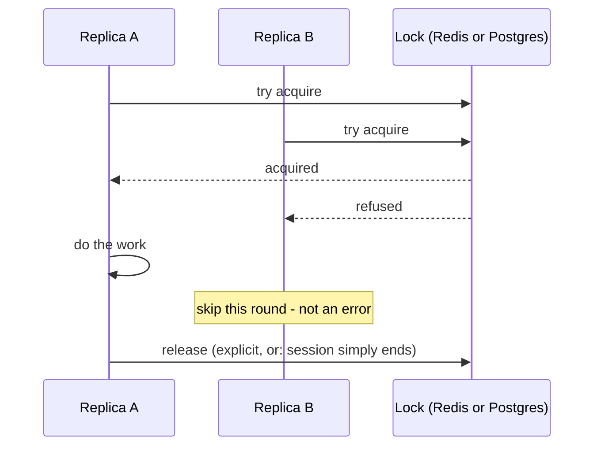

## What it is

Mutual exclusion coordinated across multiple *processes* that don't share memory — "only one of
these replicas may do X right now" — enforced by a third party every replica can reach, not by
anything in-process. A C# `lock`/`SemaphoreSlim`/`Mutex` only ever coordinates threads inside one
process; the instant a feature scales past one replica, none of that helps at all, because the
other replica isn't running the same CLR.

## What it solves

Several places in this project assumed "I'm the only instance of this running" back when the
service in question could only ever have one replica. Scaling past one replica (the "scalable"
control-plane capability — see [Pooler scaling](pattern:pooler-scaling) for the same idea applied
to pgcat) makes that assumption actively wrong, not just stale:

- **`PartitionMaintenanceWorker`** (TrafficService) ticks a 24h timer on every replica
  independently. Without coordination, N replicas all try the same `CREATE`/`DROP TABLE` DDL at
  once on the same tick.
- **`TopLinksPushService`** (ReportingApi) reacts to the same Redis pub/sub notification on every
  replica independently. Once a SignalR Redis backplane lets any replica deliver to any client (see
  [Async messaging](pattern:async-messaging) for the backplane itself), every replica that
  independently decides "push now" delivers the same push, once per replica.

Neither case needs fairness, ordering, or a queue — just "whichever replica gets there first
proceeds, the rest skip this round." That's a lock, not a queue.

## How it works

Any distributed lock needs four things:

1. A coordinator every replica can already reach — reusing an existing shared dependency
   (Postgres, Redis) rather than standing up a new one just for locking.
2. An atomic "claim it, unless someone already has" primitive — a plain read-then-write from two
   replicas has a race window between the read and the write; the primitive has to make check and
   set happen as one indivisible server-side step.
3. A way to stop an abandoned lock from being held forever if its owner dies mid-critical-section.
   **This is the genuinely hard part**, and the one place the two implementations below diverge in
   kind, not just in syntax.
4. Whoever is refused the claim has to treat that as an expected, non-exceptional outcome ("someone
   else is handling this") — the same shape as treating a refused cache slot or an open circuit
   breaker as a normal branch, not an error path (see [Circuit breakers](pattern:circuit-breakers)).

### The hard part: what happens when the holder dies mid-critical-section

This project demonstrates two different, genuinely opposite answers to that question, live:

| | Redis `SET ... NX PX` claim | Postgres advisory lock |
|---|---|---|
| Release mechanism | TTL expiry (guessed up front) or explicit delete | Session end (the connection closes) or explicit unlock |
| Recovers from a crashed holder | Yes, but only once the TTL elapses — a window where *no one* may proceed | Yes, immediately — Postgres notices the dropped connection |
| Needs a dedicated open connection? | No — works through any pooled client | Yes — must stay pinned to one physical connection for the whole critical section |
| Works through a transaction-mode pooler (pgcat)? | Yes, unaffected | No — breaks outright, see that implementation's Pitfalls |
| Used in this project for | `TopLinksPushService`'s cross-replica push claim | `PartitionMaintenanceWorker`'s create/drop DDL tick |
| Right fit when | the critical section is short and an occasional early-release double-fire is an acceptable, bounded cost | you already hold (or can hold) a direct, non-pooled Postgres connection, and want to avoid guessing a TTL at all |

A TTL-based lock trades "no dedicated connection, works anywhere" for "you have to pick a number
and live with being wrong about it" — too short and a still-working holder gets overtaken by
someone who thinks it died; too long and a genuinely dead holder blocks everyone for that whole
window. A session-scoped lock sidesteps the guessing entirely, at the cost of needing a live,
pinned connection for as long as the lock is held.

## How it's implemented here

Two call sites, deliberately using different mechanisms — not because one is wrong, but because
each fits what that call site already had available and how costly a double-fire would be there:

- **[Distributed locking: Postgres advisory locks](pattern:distributed-locking-postgres-advisory)**
  — `PartitionMaintenanceWorker` (TrafficService), session-scoped, auto-releases on crash.
- **[Distributed locking: Redis claims](pattern:distributed-locking-redis)** — `TopLinksPushService`
  (ReportingApi), TTL-scoped, no dedicated connection needed.

Neither reaches for a general-purpose distributed-lock library (e.g. a full Redlock
implementation) — both are small, hand-rolled, and scoped to exactly the one failure mode each
call site actually needs to survive. See each doc for why that was the right call here rather than
a shortcut.

## Pitfalls

- ⚠️ [A session-scoped advisory lock could be released on the wrong connection](pitfall:partition-maintenance-advisory-lock-session-mismatch) (connection-pooling) — fixed
- ⚠️ [Per-process push state plus a cross-replica backplane means every watching replica fires independently](pitfall:signalr-backplane-double-push-no-cluster-claim) (architecture-bug) — fixed

## Relatives

### Nodes

- [TrafficService](node:traffic-service) — the Postgres advisory-lock call site
- [ReportingApi](node:reporting-api) — the Redis claim call site
- [Redis (master)](node:redis-master) — the coordinator behind the Redis implementation

### Patterns

- [Distributed locking: Postgres advisory locks](pattern:distributed-locking-postgres-advisory)
- [Distributed locking: Redis claims](pattern:distributed-locking-redis)
- [Data retention](pattern:data-retention-partitioning) — the real feature the advisory lock coordinates
- [Circuit breakers](pattern:circuit-breakers) — a different coordination problem (protecting a
  dependency, not coordinating replicas), solved with the same "a refusal is a normal branch, not
  an error" shape
