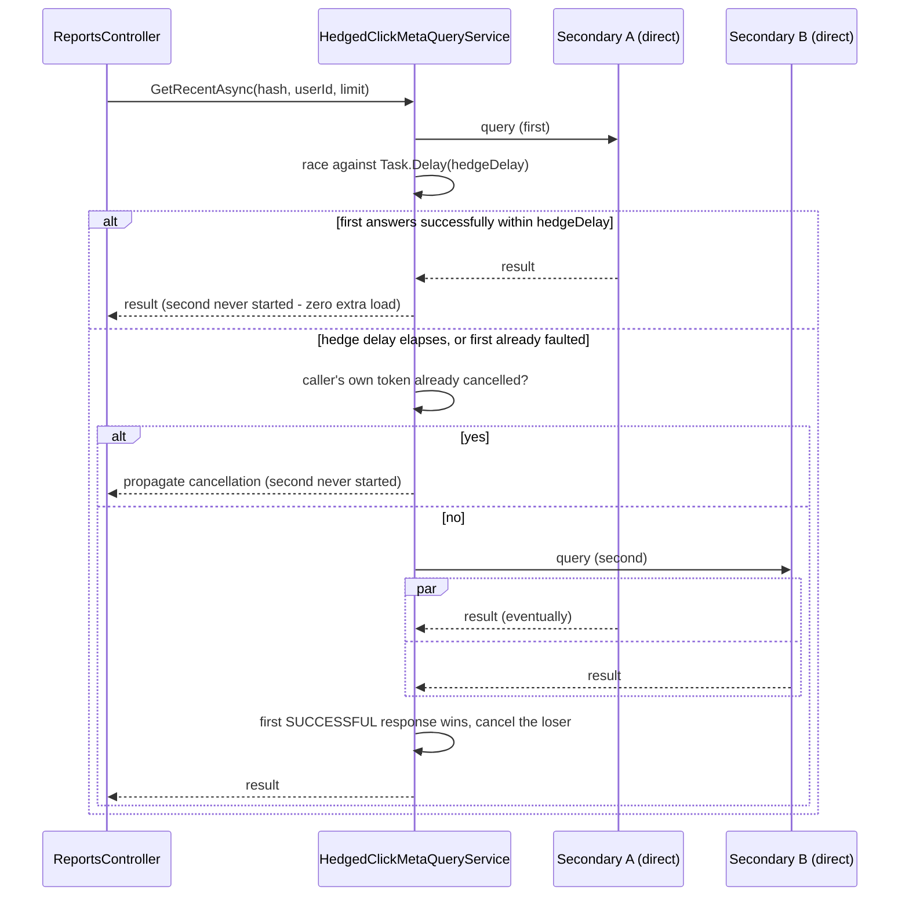

## What it is

For one read, send the same request to two (or more) redundant nodes that can both answer it, and
take whichever one answers first — discarding the slower one once a winner exists. The general
technique is sometimes called "tied requests" or "hedged requests"; this project's own version is
deliberately simple (race exactly 2, deferred-start) rather than a fully general N-way implementation.

## What it solves

This project already has [read-replica routing](pattern:read-replica-routing) (Postgres via PgCat)
— but routing and hedging solve two different problems, and it's worth being precise about the
difference:

- **Routing** picks **one** node **ahead of time** for a given request (primary vs. replica, or
  load-balanced across replicas) and sends the request there. It spreads *load* across nodes. If
  the one node it picked happens to be slow right now (a GC pause, a noisy neighbor, a transient
  network hiccup), the request is slow — nothing about routing itself notices or reacts to that
  per-request.
- **Hedging** races the **same** request against **more than one** node and keeps whichever answers
  first. It spends extra, (usually) redundant work to cut **tail latency** — the slow node loses
  the race instead of being the only option.

`GET /reports/{hash}/clicks` (ReportingApi, reading `clicks_meta_db` — a 3-node MongoDB replica set)
is where this project uses hedging. Before this feature, a plain replica-set-aware Mongo client
picked exactly one node per query (via `readPreference`) and waited on it; if that one node was
briefly slow, the whole request was slow, even with two other nodes holding the same data sitting
idle and healthy. Hedging fixes that for this one query path without touching the replica set's
actual replication mechanics at all — see [Mongo](node:mongo1) for those.

## How it works

`HedgedClickMetaQueryService` wraps the ordinary query service with a deliberately non-naive race:
not "always fire both queries, take the fastest" (which would simply double Mongo's load on every
single request), but a **hedge-delay race** — start one call, give it a head start, and only start a
second if the first hasn't answered (or has failed) by the time the head start runs out.



**The algorithm (`RaceAsync<T>`), step by step:**

1. Start `first` immediately, race it against `Task.Delay(hedgeDelay)` (default 15ms).
2. If `first` finishes *successfully* within `hedgeDelay`, return it directly — `second` is never
   started. This is the common case, and the whole reason this isn't a naive always-fire-both race:
   under normal conditions it costs exactly one query, same as no hedging at all.
3. Otherwise (the hedge delay elapsed with `first` still pending, **or** `first` already faulted
   within the delay — both treated identically, since a quick failure is no reason to skip trying a
   second replica) check whether the *caller's own* cancellation token is already signalled (e.g. an
   aborted HTTP request). If so, skip starting `second` entirely — nothing would ever read its
   result.
4. Otherwise start `second` and race both. Whichever completes *successfully* first wins; the
   loser is cancelled (never the winner). A fault is dropped, not treated as "the race is over" — the
   loop keeps waiting on whatever's left, so one dead replica doesn't matter as long as the other is
   alive. If both fault, the real exception is rethrown.

**The disposal invariant that took three commits to get right:** every `CancellationTokenSource` in
this method is disposed **only once the task created from its token has itself reached a terminal
state** — never while that task might still be running against it. This sounds obvious stated that
way, but is easy to violate in a subtly wrong spot (disposing at method scope, or disposing a task's
own CTS synchronously right before `await`ing that very task) — see this pattern's own Pitfalls
below for the full before/after and why it recurred once even after the first fix.

### Primary detection — live, not positional

Hedging has to avoid racing against the replica set's **primary** (querying it adds load to the node
serving writes, for no latency benefit a secondary doesn't already give). The naive way to find "the
other two" is to assume a fixed position in the host list is always the primary — this project's own
replica set [doesn't have a fixed primary](node:mongo1) (a fresh stack has come up with `mongo3`
primary; a real failover has left `mongo2` primary). `MongoExtensions.IsCurrentPrimary` runs a
synchronous `hello` command (checking `isWritablePrimary`, MongoDB 5.0+'s replacement for the legacy
`ismaster` field) against each candidate node once, at host startup, and excludes whichever one
answers true — see [this pitfall](pitfall:mongo-hedge-static-primary-assumption) for the real bug
the positional shortcut caused and how the live check replaced it.

This check runs once, at startup — not per request. If the replica set's primary changes *after*
ReportingApi has already started, the hedge pool keeps using the primary it detected at boot until
the process restarts (the pre-existing "Replicas (MongoDB)" standing toggle flipping between starts
is fine, handled by the `hedgeNodes.Count < 2` fallback below — it's specifically a mid-process
failover that this doesn't react to live).

### Falling back when there's nothing to hedge against

`GetRecentAsync` calls the plain `fallback` query service directly whenever `hedgeNodes.Count < 2` —
e.g. the Mongo-replicas toggle is off, so `rs0` only has one member, and there's nothing to race.
Hedging silently degrades to "exactly the pre-hedging behavior" rather than erroring or forcing
replicas to exist.

### The control dial

`Mongo:HedgeDelayMs` (env `MONGO_HEDGE_DELAY_MS`, default `15`) sets how long the first call gets
before a second is started. Read once at service startup, not live-reloaded. The `mongo-hedge-delay`
control-api capability (`GET`/`POST /api/infra/mongo-hedge-delay`, `[0, 5000]` ms) follows this
project's standard numeric-dial shape — cache the value, write the env var, force-recreate the one
affected container (`reporting-api`) — exposed in architecture-map as a control on the `reporting-api`
node. Setting it to `0` makes every request race both secondaries from the very start — useful for
*demonstrating* the mechanism live, at the cost of doubling load on this one query path for as long
as it's set that way.

## How it's implemented here

```csharp
// src/backend/Shared/Infrastructure/HedgedClickMetaQueryService.cs:52 (shape, see the pitfall
// below for the full before/after on the CTS lifetime this code has to get right)
internal async Task<T> RaceAsync<T>(
    Func<CancellationToken, Task<T>> first,
    Func<CancellationToken, Task<T>> second,
    TimeSpan hedgeDelay,
    CancellationToken cancellationToken)
{
    var ctsFirst = CancellationTokenSource.CreateLinkedTokenSource(cancellationToken);
    var firstTask = first(ctsFirst.Token);

    var delayTask = Task.Delay(hedgeDelay, cancellationToken);
    var completedEarly = await Task.WhenAny(firstTask, delayTask);
    if (completedEarly == firstTask && firstTask.IsCompletedSuccessfully)
    {
        ctsFirst.Dispose(); // safe here - firstTask is already done
        return await firstTask;
    }
    // ... caller-cancellation short-circuit, then starts `second` and races both ...
}
```

```csharp
// src/backend/Shared/Infrastructure/MongoExtensions.cs:36, AddMongoClickMetaReader (shape)
var hedgeNodes = url.Servers
    .Where(server => !IsCurrentPrimary(BuildDirectConnectionString(server))) // live hello check
    .Select(server => new MongoClickMetaQueryService(/* direct-connected, directConnection=true */));
services.AddSingleton<IClickMetaQueryService>(sp => new HedgedClickMetaQueryService(
    fallback: /* plain replica-set-aware MongoClickMetaQueryService */,
    hedgeNodes: hedgeNodes,
    hedgeDelay: TimeSpan.FromMilliseconds(configuration.GetValue("Mongo:HedgeDelayMs", 15)),
    logger: sp.GetRequiredService<ILogger<HedgedClickMetaQueryService>>()));
```

Dependencies: `MongoDB.Driver` (the `hello` command via a direct, non-replica-set-discovering
connection — `directConnection=true`, distinct from the ordinary replica-set-following connection
`fallback` uses); no new package. Covered by 8 unit tests against `RaceAsync`/`GetRecentAsync`
(`src/backend/tests/Infrastructure.Tests/HedgedClickMetaQueryServiceTests.cs`), all via mocks — no
real Mongo dependency, which is also exactly why the disposal bug below wasn't test-caught at the
time it was introduced (see that pitfall's own "honestly flagged gap").

## Pitfalls

- ⚠️ [Disposing a `CancellationTokenSource` the instant it's "no longer needed," not once its task is actually done](pitfall:cts-disposed-before-task-finishes)
  (concurrency) — fixed
- ⚠️ [Assuming the first host in a replica-set connection string is always the primary](pitfall:mongo-hedge-static-primary-assumption)
  (architecture-bug) — fixed

## Relatives

### Nodes

- [ReportingApi](node:reporting-api) — the only current consumer (`GET /reports/{hash}/clicks`)
- [Mongo](node:mongo1) — the replica set being hedged against

### Patterns

- [Read-replica routing](pattern:read-replica-routing) — same "multiple replicas, one logical read"
  shape, opposite trade-off: routing picks one node ahead of time to spread load, hedging races
  more than one to cut tail latency
- [High availability & failover](pattern:high-availability-failover) — the replica set's own
  election/failover mechanics, which is exactly what makes "ask who's primary live" necessary here
