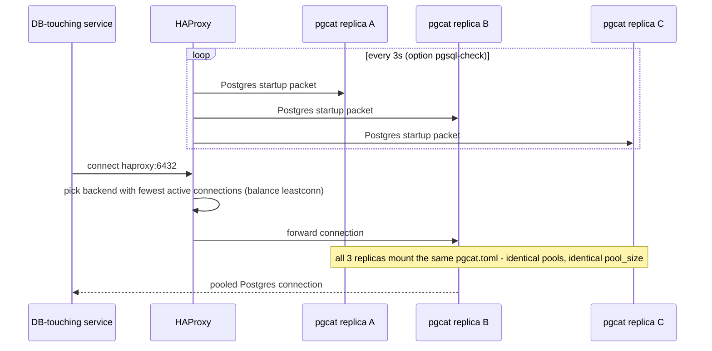

## What it is

Running several identical instances of a connection pooler ([PgCat](node:pgcat), here) behind a
load balancer ([HAProxy](node:haproxy)), instead of one — and, specifically, what has to be
recalculated (not just multiplied) when you do.

## What it solves

A single PgCat instance is a single point of failure for every Postgres-touching service in this
project — if it goes down, every one of them loses its database. It's also a throughput ceiling:
one process handling every pooled connection for `users_db`/`links_db`/`clicks_db`. Running several
identical replicas behind a load balancer fixes both — one instance going down doesn't take
Postgres access down with it, and connection load spreads across however many replicas exist.

## How it works

1. **One Compose service, scaled — not several separately-named services.** `pgcat` is one service
   at `deploy.replicas: 3`, the same native mechanism `link-api`/`redirect-api`/etc. already use
   when scaled — not 3 independently-configured instances that happen to look alike. This wasn't
   the first shape tried; see "A real design correction" below.
2. **HAProxy balances across the replicas**, `leastconn`, with a Postgres-protocol-aware health
   check (`option pgsql-check`) — see [HAProxy](node:haproxy) for why a bare TCP check isn't enough
   and the two real DNS bugs that came from scaling a Compose service this way.
3. **One shared `pgcat.toml`**, mounted read-only into all 3 replicas — not 3 separate config files
   to keep in sync. The existing pool-settings control barely had to change: "rewrite one file"
   already meant "change all 3 replicas" for free, since they all mount the same file.
4. **Every DB-touching service connects to `haproxy:6432`**, never to `pgcat` directly — one line
   (`DB_HOST`'s default) is what the pgcat-bypass control actually pivots on.



### The connection-count math this pattern exists to demonstrate

Scaling the pooler without touching its configuration is the trap this pattern is built to make
visible. `pool_size` (how many real Postgres connections one PgCat instance will open *per
database pool*) was already tuned for a single instance — see `sandbox/docs/pgcat-pool-sizing.md`
for the original investigation that landed on `pool_size = 40`. Naively running 3 replicas of that
*same* config would triple the real connection count against Postgres, not the throughput:

| | pool_size | × database pools | × pgcat replicas | = worst-case real connections |
|---|---|---|---|---|
| Before this feature | 40 | 3 | 1 | **120** |
| Naively scaled (not shipped) | 40 | 3 | 3 | **360** |
| As shipped | 20 | 3 | 3 | **180** |

`max_connections` stayed at **200**. 360 would have exceeded it outright (connections start failing
under real load, the exact failure this pattern exists to make visible); 180 leaves ~20 of headroom
for `pgweb`/exporters/admin `psql`/migrations — the same headroom reasoning the original
single-instance investigation used, just redone per-replica instead of assuming it still holds.
`pool_size` was halved (40 → 20) specifically so the *aggregate* stayed under control instead of
scaling proportionally with the replica count.

### A real design correction, not the first shape shipped

The first version of this feature used 3 separately-named Compose services (`pgcat-1`/`pgcat-2`/
`pgcat-3`) instead of one scaled service. On the architecture-map graph, that meant drawing one
"representative instance" with the real downstream edges to Postgres and leaving the other two
without any — the same convention already used for Mongo's 3-node replica set. For PgCat
specifically, that made `pgcat-2`/`pgcat-3` look broken or unused rather than identical peers, since
nothing about PgCat's own role suggested "one of these is special" the way a replica set's primary
is. The fix was switching to one scaled service with the graph's own existing `×N` badge
(`ServiceNode.tsx`, the same way `link-api`/`redirect-api`/etc. show their own replica counts) —
using an established pattern instead of inventing a situation-specific one. This also simplified the
backend: `IContainerRuntime.ListAsync` (list every container for one service, not just the primary)
replaced the per-instance route design the 3-named-services version would have needed.

**Why PgCat still isn't in control-api's generic scale control**, unlike the services the `×N`
badge pattern is borrowed from: not because HAProxy's backend list can't track a replica-count
change (it can — `server-template`, see [HAProxy](node:haproxy), re-resolves the `pgcat` DNS name
at runtime and would pick up a scale-up automatically, up to its reserved slot count). It's because
`pool_size` above is hand-calibrated for exactly 3 replicas against Postgres's `max_connections` —
scaling through the generic control without also recalculating and reapplying `pool_size` would
silently risk exhausting real Postgres connections, not just fail loudly the way a missing route
would.

**A live failure-demo control for this pattern.** Beyond the pgcat-bypass standing toggle (which
reroutes DB-touching services around the whole pooler layer, replicas included), there's a separate
toggle that stops/starts the real `haproxy` container itself — see [HAProxy](node:haproxy)'s own
"standing toggle" section for the mechanics. It's the one way to demonstrate live that PgCat's 3
replicas being perfectly healthy doesn't help if the single load balancer in front of them is down —
every DB-touching service keeps dialing `haproxy:6432` regardless, so this is a genuine outage, not a
graceful bypass. Only meaningful (and only legal to re-enable) while pgcat itself is on. This toggle
now also scales [PgCat](node:pgcat) itself down to 1 replica while HAProxy is off (and back to 3
when it's on), so the graph's `×N` badge genuinely tracks whether load-balancing is active across
real, serving instances — not just whether HAProxy happens to be running.

## How it's implemented here

```yaml
# sandbox/docker-compose.yml
pgcat:
  deploy:
    replicas: 3
  volumes:
    - ./infra/pgcat/pgcat.toml:/etc/pgcat/pgcat.toml:ro   # one file, all 3 replicas

haproxy:
  depends_on:
    pgcat:
      condition: service_healthy
```

```
# sandbox/infra/haproxy/haproxy.cfg
backend pgcat_back
    balance leastconn
    option pgsql-check user postgres
    server-template pgcat 6 pgcat:6432 check inter 3s fall 3 rise 2 resolvers docker_dns init-addr none
```

## Pitfalls

- 🐛 [A statically-resolved backend hostname failed on first boot against Docker's embedded DNS](pitfall:haproxy-static-resolve-races-docker-dns)
  (infrastructure-bug) — fixed
- 🐛 [Scaling a Compose service made per-replica hostnames stop resolving entirely](pitfall:haproxy-server-template-replaces-static-server-list)
  (infrastructure-bug) — fixed
- ⚠️ [A cached "is it running" flag went stale the instant a second, unguarded control path touched the same container](pitfall:haproxy-toggle-cached-state-bypassed-by-generic-controls)
  (concurrency) — fixed
- ⚠️ [A docker compose up --scale call without --no-deps silently restarts whatever it depends on](pitfall:pgcat-scale-missing-no-deps-restarts-stopped-replicas)
  (infrastructure-bug) — fixed
- ⚠️ [A control-plane process's in-memory cache of "what's currently toggled" has no source of truth once it restarts](pitfall:infra-toggle-state-resets-on-restart-desyncs-live-containers)
  (architecture-bug) — fixed
- ⚠️ [A docker-compose `${VAR}` substitution name never appears on the running container — only the real, rendered env var does](pitfall:control-api-reads-compose-substitution-names-not-rendered-env)
  (infrastructure-bug) — fixed

## Relatives

### Nodes

- [PgCat](node:pgcat) — the pooler this pattern scales
- [HAProxy](node:haproxy) — balances across PgCat's replicas

### Patterns

- [Read-replica routing](pattern:read-replica-routing) — the query-routing PgCat does, independent
  of how many PgCat replicas exist
